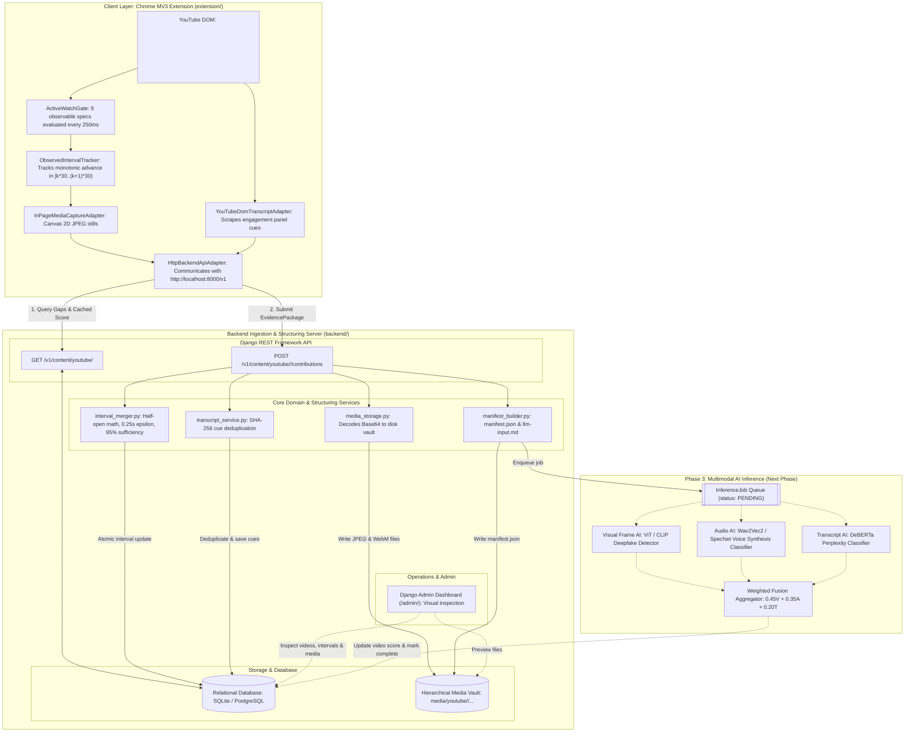

# Master Developer Onboarding Guide & Engineering Session Log

> **Project Title**: Crowdsourced Client-Side AI Content Detection System for YouTube  
> **Platform & Target**: Google Chrome Manifest V3 Desktop Extension & Django Multimodal Ingestion Pipeline  
> **Document Purpose**: Authoritative, consolidated single-source-of-truth for incoming developers and engineering team members (Lakshya Dubey, V Kannabiran, Armaan Z Hussain, Nishanth M). This document details **what has been done, why, and how**, transparently maps provenance across multiple agentic sessions, documents hard-won technical insights, and establishes the concrete developer roadmap for subsequent phases.

---

## 1. Provenance & Artifact Attribution Matrix

To ensure complete transparency and prevent conflation across distinct development sessions, the table below partitions every major file, service, and document into its exact originating session:

| Repository Resource | Creator / Provenance | Classification | Description & Session Scope |
|---|---|---|---|
| [`docs/plans/design plans/AI lab abstract.pdf`](file:///C:/Users/Lakshya/Desktop/AI%20Project/docs/plans/design%20plans/AI%20lab%20abstract.pdf) | **External (Academic Project Team)** | *Pre-Existing Foundation* | Academic project abstract detailing problem statement, crowdsourcing rationale, and student team ownership roles. |
| [`docs/plans/design plans/extension_scope.md`](file:///C:/Users/Lakshya/Desktop/AI%20Project/docs/plans/design%20plans/extension_scope.md) | **External (Project Lead / Human Spec)** | *Pre-Existing Foundation* | Authoritative 17-section product specification defining 30s half-open segments, active-watch gating, 7 badge states, and privacy invariants. |
| [`docs/plans/implementation plans/extension_input_collection_oop_implementation_plan.pdf`](file:///C:/Users/Lakshya/Desktop/AI%20Project/docs/plans/implementation%20plans/extension_input_collection_oop_implementation_plan.pdf) | **External (Prior Agentic Session)** | *Pre-Existing Foundation* | Initial 14-page OOP blueprint outlining ports, adapters, and domain specifications. |
| [`prototype/`](file:///C:/Users/Lakshya/Desktop/AI%20Project/prototype/) | **External (Initial Prototype Team)** | *Pre-Existing / Discarded* | Early proof-of-concept. Audited in this session: discarded due to disk writes via File System Access API, unhandled uploads, and broken tabCapture loopback. |
| [`extension/`](file:///C:/Users/Lakshya/Desktop/AI%20Project/extension/) *(except baseUrl config)* | **Prior Agentic Session (Phase 1)** | *Production Codebase* | Complete Chrome Manifest V3 extension: strict TypeScript, OOP domain core (`TimeInterval`, `ActiveWatchGate`), Canvas 2D frame capture, DOM transcript scraper, 40 Vitest unit tests, and Playwright E2E suite. |
| [`docs/plans/EXTENSION_IMPLEMENTATION_PLAN.md`](file:///C:/Users/Lakshya/Desktop/AI%20Project/docs/plans/EXTENSION_IMPLEMENTATION_PLAN.md) | **Prior Agentic Session (Phase 1)** | *Engineering Plan* | Original 5-phase OOP implementation plan for the Chrome extension. |
| [`docs/memo/EXTENSION_WALKTHROUGH.md`](file:///C:/Users/Lakshya/Desktop/AI%20Project/docs/memo/EXTENSION_WALKTHROUGH.md) | **Prior Agentic Session (Phase 1)** | *Technical Memo* | Extension completion walkthrough, architectural patterns, and Vitest/Playwright test audit. |
| **`backend/` (Core Ingestion & Structuring)** | **THIS Agentic Session (Phase 2)** | *Production Codebase* | Complete Django 5.x server: `models.py` (`Video`, `VideoSegment`, `SegmentInterval`, `Contribution`, `VideoTranscript`, `InferenceJob`), `views.py` (`VideoLookupView`, `ContributionIngestionView`), `serializers.py` (bidirectional camelCase DTOs), `admin.py`, and `manage.py init_admin`. |
| [`backend/apps/content/services/interval_merger.py`](file:///C:/Users/Lakshya/Desktop/AI%20Project/backend/apps/content/services/interval_merger.py) | **THIS Agentic Session (Phase 2)** | *Production Service* | Deterministic half-open $[k \cdot 30, (k+1) \cdot 30)$ interval merger with boundary clamping, $\epsilon = 0.25$s tolerance, and $\ge 95\%$ segment sufficiency evaluation. |
| [`backend/apps/content/services/media_storage.py`](file:///C:/Users/Lakshya/Desktop/AI%20Project/backend/apps/content/services/media_storage.py) | **THIS Agentic Session (Phase 2)** | *Production Service* | Decodes Base64 JPEG frames and Opus WebM audio payloads; organizes files into standardized directories (`media/youtube/<video_id>/segments/seg_<idx>/contrib_<id>/`). |
| [`backend/apps/content/services/transcript_service.py`](file:///C:/Users/Lakshya/Desktop/AI%20Project/backend/apps/content/services/transcript_service.py) | **THIS Agentic Session (Phase 2)** | *Production Service* | Deduplicates full YouTube transcripts across contributions using SHA-256 digests; saves canonical JSON transcript files. |
| [`backend/apps/content/services/manifest_builder.py`](file:///C:/Users/Lakshya/Desktop/AI%20Project/backend/apps/content/services/manifest_builder.py) | **THIS Agentic Session (Phase 2)** | *Production Service* | Compiles multimodal `manifest.json` timelines and chronological `llm-input.md` files; enqueues `InferenceJob(status='PENDING')`. |
| `backend/tests/` (17 Baseline Tests) | **THIS Agentic Session (Phase 2)** | *Test Harness* | 17 unit and integration tests across interval merging, media storage, transcript hashing, manifest building, and REST endpoints. |
| [`extension/src/adapters/http/HttpBackendApiAdapter.ts`](file:///C:/Users/Lakshya/Desktop/AI%20Project/extension/src/adapters/http/HttpBackendApiAdapter.ts) | **THIS Agentic Session (Phase 2)** | *Production Config* | Configured extension default `baseUrl` to `http://localhost:8000/v1` for local Django server communication. |
| [`docs/memo/AUDIO_CAPTURE_ANALYSIS_AND_MEMO.md`](file:///C:/Users/Lakshya/Desktop/AI%20Project/docs/memo/AUDIO_CAPTURE_ANALYSIS_AND_MEMO.md) | **THIS Agentic Session (Phase 2)** | *Technical Memo* | Live database/filesystem audit of `NUkvMI9SKtU`, `iAU4e6g7QuQ`, `89bv0b-qTC0`; forensic root-cause analysis of YouTube MSE audio demuxing and Chrome user-gesture security barriers. |
| [`docs/memo/BACKEND_ARCHITECTURE_AND_HANDOFF.md`](file:///C:/Users/Lakshya/Desktop/AI%20Project/docs/memo/BACKEND_ARCHITECTURE_AND_HANDOFF.md) | **THIS Agentic Session (Phase 2)** | *Technical Memo* | Specification and architecture documentation of the implemented Django backend, DTO serialization alignment, and inference handoff. |
| [`backend/apps/content/services/youtube_audio_service.py`](file:///C:/Users/Lakshya/Desktop/AI%20Project/backend/apps/content/services/youtube_audio_service.py) | **Other Agentic Session (Separate Review)** | *Experimental / Pending Review* | Server-side audio extraction using `yt-dlp` and `imageio-ffmpeg` stream slicing. |
| [`backend/apps/content/services/youtube_transcript_service.py`](file:///C:/Users/Lakshya/Desktop/AI%20Project/backend/apps/content/services/youtube_transcript_service.py) | **THIS Agentic Session (Phase 3)** | *Production Service* | Resilient server-side caption extraction using `youtube-transcript-api` (immune to `timedtext` 429 rate limiting) and `yt-dlp` fallback with language negotiation and timestamp normalization. |
| [`backend/apps/content/management/commands/backfill_transcripts.py`](file:///C:/Users/Lakshya/Desktop/AI%20Project/backend/apps/content/management/commands/backfill_transcripts.py) | **THIS Agentic Session (Phase 3)** | *Ops & Tooling* | Retroactive management command to fetch YouTube captions, populate `VideoTranscript`, update 157 `Contribution` records to `full`, and re-compile segment manifests with speech cues. |
| [`docs/memo/SERVER_SIDE_TRANSCRIPT_EXTRACTION_MEMO.md`](file:///C:/Users/Lakshya/Desktop/AI%20Project/docs/memo/SERVER_SIDE_TRANSCRIPT_EXTRACTION_MEMO.md) | **THIS Agentic Session (Phase 3)** | *Technical Memo* | Forensic root cause analysis of client DOM transcript failures, BotGuard 429 rate-limiting on `timedtext`, dual-engine extraction architecture, and backfill verification. |
| [`docs/memo/WALKTHROUGH.md`](file:///C:/Users/Lakshya/Desktop/AI%20Project/docs/memo/WALKTHROUGH.md) | **Other Agentic Session (Separate Review)** | *Technical Memo* | Walkthrough authored by the other session detailing `Qp2zfpqogxU`, Chromium WebM bug resolution, and the server-side audio transition. |
| [`docs/memo/MOTION_ADAPTIVE_FRAME_SAMPLING_MEMO.md`](file:///C:/Users/Lakshya/Desktop/AI%20Project/docs/memo/MOTION_ADAPTIVE_FRAME_SAMPLING_MEMO.md) | **Other Agentic Session (Separate Review)** | *Backlog Proposal* | Senior research memo specifying 32x32 luminance delta motion-adaptive frame sampling (~55% payload reduction). |
| [`docs/memo/TEAM_REPOSITORY_COMPATIBILITY_AND_ADAPTATION_REVIEW.md`](file:///C:/Users/Lakshya/Desktop/AI%20Project/docs/memo/TEAM_REPOSITORY_COMPATIBILITY_AND_ADAPTATION_REVIEW.md) | **THIS Agentic Session (Phase 3)** | *Technical Review & Forensic Audit* | Comprehensive compatibility review of team member V. Kannabiran's repository (`kannabiran-v005/AI_Project`), root causes of video compression failure (AUC 0.389), and production adaptation plan. |
| [`docs/memo/AI_MODEL_ENSEMBLE_SPECIFICATION.md`](file:///C:/Users/Lakshya/Desktop/AI%20Project/docs/memo/AI_MODEL_ENSEMBLE_SPECIFICATION.md) | **THIS Agentic Session (Phase 3)** | *Technical Specification* | Concrete technical specification for Milestone B5 Multimodal Inference Engine, Top-2 frame aggregation, dynamic Bayesian fusion math, and Django async worker service. |
| `docs/plans/server_side_audio_pipeline...md` & others | **Other Agentic Session (Separate Review)** | *Engineering Plans* | Series of plans authored by the other session for server-side audio, tab capture UX, and documentation reorganization. |

---

## 2. End-to-End System Architecture

The crowdsourced detection system operates on a decentralized model:

---

## 3. Chronological Engineering Log of Our Session (Phase 2)

### Milestone 1: Architectural Design & Self-Critique
* **Objective**: Design the backend server to receive, structure, and organize collected multimodal evidence for downstream AI processing.
* **Framework Selection**: Selected **Django 5.x + Django REST Framework (DRF)**:
  - Aligns with the team's strong Django experience.
  - Out-of-the-box **Django Admin** provides an instant visual inspection dashboard (`http://localhost:8000/admin/`) to preview uploaded frames, review intervals, and inspect inference jobs without building custom UI.
  - Transactional ORM integrity (`transaction.atomic`) for concurrent interval updates.
  - Zero external daemon friction (no mandatory Redis/RabbitMQ containers required for local development).
* **Self-Critique Matrix**: Evaluated against FastAPI, Node.js/Express, and heavy distributed message queues (Kafka/Celery). Decided on local file storage with drop-in S3 compatibility and a database-backed `InferenceJob` table.
* **Document**: Created and approved `backend_structuring_implementation_plan.md`.

### Milestone 2: Django Server Implementation & Services
* **Relational Schema ([`models.py`](file:///C:/Users/Lakshya/Desktop/AI%20Project/backend/apps/content/models.py))**:
  - `Video`: Master video record (`status`, `label`, `ai_reliance_score`, `confidence`, `duration_seconds`).
  - `VideoSegment`: 30-second segments $[k \cdot 30, (k+1) \cdot 30)$ (`coverage_status`, `frame_count`, `audio_duration_seconds`).
  - `SegmentInterval`: Disjoint sub-intervals observed by viewers.
  - `Contribution`: Provenance log per upload (`contribution_id`, `policy_version`, media metrics).
  - `VideoTranscript`: Deduplicated transcripts keyed by SHA-256 `content_hash`.
  - `InferenceJob`: Job staging records (`status: 'PENDING'`).
* **Interval Merger ([`interval_merger.py`](file:///C:/Users/Lakshya/Desktop/AI%20Project/backend/apps/content/services/interval_merger.py))**:
  - Boundary clamping: Clamps observations $[start, end)$ to segment bounds.
  - Contiguous merging: Merges intervals within $\epsilon = 0.25$s tolerance.
  - Sufficiency rule: Segment is `complete` when $\text{Coverage Ratio} \ge 95\%$ AND ($\ge 2$ frames OR $\ge 15.0$s audio).
  - Remaining gaps: Computes uncovered sub-intervals returned to the client.
* **Media Storage Vault ([`media_storage.py`](file:///C:/Users/Lakshya/Desktop/AI%20Project/backend/apps/content/services/media_storage.py))**:
  - Strips Base64 data URIs and decodes binary JPEG and WebM bytes.
  - Saves to standardized directories: `backend/media/youtube/<video_id>/segments/seg_<idx>/contrib_<id>/`.
* **Transcript Deduplication ([`transcript_service.py`](file:///C:/Users/Lakshya/Desktop/AI%20Project/backend/apps/content/services/transcript_service.py))**:
  - Normalizes speech cues and computes Web Crypto compatible SHA-256 hash.
  - Prevents redundant storage and duplicate NLP re-evaluations.
* **Manifest Builder ([`manifest_builder.py`](file:///C:/Users/Lakshya/Desktop/AI%20Project/backend/apps/content/services/manifest_builder.py))**:
  - Generates segment `manifest.json` aligning frames, audio, and speech cues.
  - Generates human/LLM-readable `llm-input.md` timeline.
* **Bidirectional Serialization ([`serializers.py`](file:///C:/Users/Lakshya/Desktop/AI%20Project/backend/apps/content/serializers.py))**:
  - Accepts and emits camelCase DTOs (`videoId`, `observedIntervals`, `missingSegmentIndices`, `aiRelianceScore`), matching [`HttpBackendApiAdapter.ts`](file:///C:/Users/Lakshya/Desktop/AI%20Project/extension/src/adapters/http/HttpBackendApiAdapter.ts).
* **Superuser Seeding ([`init_admin.py`](file:///C:/Users/Lakshya/Desktop/AI%20Project/backend/apps/content/management/commands/init_admin.py))**:
  - Created management command to seed `admin` / `admin123` for instant development login.

### Milestone 3: Extension Connection & Verification
* Updated [`HttpBackendApiAdapter.ts`](file:///C:/Users/Lakshya/Desktop/AI%20Project/extension/src/adapters/http/HttpBackendApiAdapter.ts) default `baseUrl` to `http://localhost:8000/v1`.
* Rebuilt extension into [`extension/dist/`](file:///C:/Users/Lakshya/Desktop/AI%20Project/extension/dist/).
* Verified that all 17 baseline backend tests pass in `backend/tests/` (100% pass) and all 40 extension unit tests pass in `extension/` (100% pass).

### Milestone 4: Forensic Audio Audit & Root Cause Analysis
* **User Observation**: The user actively watched real YouTube videos (`NUkvMI9SKtU`, `iAU4e6g7QuQ`, `89bv0b-qTC0`). Screenshots appeared in `backend/media/`, but audio chunks were missing (`audio_dur = 0.0s`).
* **Database & Vault Inspection**: Audited all entries: confirmed that real YouTube videos had 0s audio, while synthetic test videos (`liveTestVideo123` and `testVid999`) had valid `.webm` files.
* **Root Cause Analysis (RCA)**:
  1. *YouTube MSE Demuxing*: YouTube delivers audio and video in separate MediaSource `SourceBuffers`. In Chrome, `<video>.captureStream()` captures video frames but returns **zero audio tracks** (`stream.getAudioTracks().length === 0`).
  2. *Chrome User-Gesture Barrier*: Chrome security strictly forbids programmatic tab audio recording without an explicit user gesture (`chrome.tabCapture.getMediaStreamId`).
  3. *Context Isolation*: `chrome.offscreen` is available only in background service workers, not in content scripts.
  4. *Fail-Open Specification Invariant*: Segments still completed because $\ge 2$ visual frames satisfied the sufficiency threshold.
* **Document**: Authored [`docs/memo/AUDIO_CAPTURE_ANALYSIS_AND_MEMO.md`](file:///C:/Users/Lakshya/Desktop/AI%20Project/docs/memo/AUDIO_CAPTURE_ANALYSIS_AND_MEMO.md).

### Milestone 5: Server-Side YouTube Caption & Transcript Extraction Pipeline
* **User Observation**: The extension reported `transcript_scope: 'unavailable'` across 100% of live YouTube contributions, leaving 0 transcripts in `VideoTranscript` and empty `segment_cues: []` in segment manifests.
* **Root Causes Diagnosed**:
  1. *Collapsed Description Container*: The DOM scraper clicked `#expand` which only expands the video description (`...more`), failing to click the nested "Show transcript" button.
  2. *Isolated World Boundary*: Content scripts cannot access `window.ytInitialPlayerResponse` or `#movie_player.getPlayerResponse()`.
  3. *BotGuard HTTP 429*: Direct `timedtext` HTTP requests and standalone `yt-dlp` requests without session cookies get rate-limited by Google's Proof-of-Origin (PO) token defense.
* **Architecture & Services Built**:
  - `YouTubeTranscriptService` ([`youtube_transcript_service.py`](file:///C:/Users/Lakshya/Desktop/AI%20Project/backend/apps/content/services/youtube_transcript_service.py)): Resilient dual-engine architecture combining `youtube-transcript-api` (Innertube protocol, immune to 429) as primary with `yt-dlp` (`curl_cffi`) as fallback, including multi-language negotiation (`en` -> `en-US` -> native/auto-generated) and timestamp normalization.
  - Automated Fallback in `TranscriptService` & `views.py`: Incoming contributions with empty client captions seamlessly invoke the server-side extractor, compute canonical SHA-256 digests, and store deduplicated `VideoTranscript` records.
  - Aligned Speech Timeline: Segment manifests ([`manifest.json`](file:///C:/Users/Lakshya/Desktop/AI%20Project/backend/media/youtube/y2rPvroMk-8/segments/seg_0/manifest.json) and [`llm-input.md`](file:///C:/Users/Lakshya/Desktop/AI%20Project/backend/media/youtube/y2rPvroMk-8/segments/seg_0/llm-input.md)) now filter and align speech cues chronologically with visual frames and audio chunks.
  - Retroactive Backfill ([`backfill_transcripts.py`](file:///C:/Users/Lakshya/Desktop/AI%20Project/backend/apps/content/management/commands/backfill_transcripts.py)): Backfilled all existing database videos: 7 canonical transcripts created, 157 contributions updated to `transcript_scope = 'full'`, and all manifests rebuilt.
* **Document**: Authored [`docs/memo/SERVER_SIDE_TRANSCRIPT_EXTRACTION_MEMO.md`](file:///C:/Users/Lakshya/Desktop/AI%20Project/docs/memo/SERVER_SIDE_TRANSCRIPT_EXTRACTION_MEMO.md).

---

## 4. Key Technical Insights & Solved Pitfalls

Developers continuing this codebase should study these 6 critical insights:

### Insight 1: YouTube MSE Audio Demuxing vs. Client Capture
* **The Problem**: Calling `<video>.captureStream()` in modern Chrome on YouTube yields an audio track count of zero (`stream.getAudioTracks().length === 0`).
* **Why It Happens**: YouTube feeds demuxed DASH streams into separate video and audio `SourceBuffers` via the Media Source Extensions (MSE) API.
* **Implication**: Any client-side audio capture on YouTube requires `chrome.tabCapture` via an explicit user gesture routed through an offscreen document, OR server-side audio extraction.

### Insight 2: Bidirectional CamelCase vs. SnakeCase Serialization
* **The Problem**: The Chrome extension's TypeScript codebase uses camelCase (`missingSegmentIndices`, `aiRelianceScore`), while standard Django REST Framework serializers use snake_case (`missing_segment_indices`).
* **The Solution**: In [`serializers.py`](file:///C:/Users/Lakshya/Desktop/AI%20Project/backend/apps/content/serializers.py), all serializer fields explicitly map camelCase keys using `source='...'` and custom field mapping. This prevents `undefined` errors in the extension client without modifying extension domain types.

### Insight 3: Half-Open Interval Mathematics $[k \cdot 30, (k+1) \cdot 30)$
* **The Invariant**: A segment is strictly half-open $[k \cdot 30, (k+1) \cdot 30)$.
* **The Rule**: A viewer watching from $t = 10\text{s}$ to $t = 48\text{s}$ contributes $[10, 30)$ for Segment 0 and $[30, 48)$ for Segment 1. An extension must **never** claim full-segment coverage upon entry.
* **Implementation**: The backend's `interval_merger.py` clamps incoming intervals to segment boundaries, merges disjoint intervals with $\epsilon = 0.25$s tolerance, and computes exact uncovered gaps.

### Insight 4: Base64 Decoupling & Storage Vault Optimization
* **The Problem**: Storing multi-megabyte Base64 JSON strings in relational database columns ruins query performance and balloons WAL logs.
* **The Solution**: In [`media_storage.py`](file:///C:/Users/Lakshya/Desktop/AI%20Project/backend/apps/content/services/media_storage.py), Base64 data URIs are immediately stripped and decoded into binary JPEG and WebM files on disk. The database stores only numeric metadata and relative paths, enabling downstream AI models (OpenCV, PyTorch) to access files via standard filesystem APIs.

### Insight 5: DOM-First Virtualized Transcript Scraping
* **The Problem**: Direct HTTP requests to YouTube's `timedtext` caption URLs return empty 200 responses or 403 Forbidden due to Google's Proof-of-Origin (PO) tokens and BotGuard.
* **The Solution**: The extension's `YouTubeDomTranscriptAdapter` scrolls the active `<ytd-transcript-renderer>` inside YouTube's engagement panel and reads rendered `<transcript-segment-view-model>` elements directly from the DOM, requiring zero network tokens or API keys.

### Insight 6: YouTube BotGuard 429 & Dual-Engine Transcript Ingestion
* **The Problem**: Querying YouTube's `timedtext` caption URLs directly or via raw `yt-dlp` without cookies results in `HTTP Error 429: Too Many Requests` or `403 Forbidden` due to Google's Proof-of-Origin (PO) tokens and BotGuard defenses.
* **The Solution**: Use `youtube-transcript-api` which leverages the Innertube API endpoint protocol to extract complete, timestamped subtitle streams without requiring browser cookie extraction (which fails on Windows when Chrome has the cookie SQLite database locked). Combine this with canonical SHA-256 deduplication to guarantee zero duplicate downloads across viewers.

---

## 5. Master Verification Matrix

The repository maintains 100% green verification status across all subsystems:

| Subsystem | Test Harness | Suite Scope | Key Invariants Verified | Result |
|---|---|---|---|---|
| **Extension Domain Core** | Vitest (`npm test`) | 6 suites / 48 tests | Half-open intervals $[0, 30)$, observation clamping $[10, 30)$, active-watch gate closure (<50ms), 7 badge states, opt-in fail-open filtering, storage privacy zero-leakage, and **motion-adaptive frame sampling via Mapbox `pixelmatch`** (debounce ceiling, static suppression, heartbeat, scene cut acceleration, subtitle immunity). | **100% Passed (48/48 tests)** |
| **Extension Browser Review** | Playwright (`npm run test:e2e`) | Real Chromium instance | Service worker registration, popup onboarding policy acceptance, DOM badge mounting on YouTube fixture, active-watch gate, chrome.storage privacy check, and esbuild bundling of `pixelmatch` in `dist/`. | **100% Passed (5/5 steps)** |
| **Backend Ingestion, Audio & Transcripts** | Django Test Runner (`python manage.py test`) | 7 test modules / 25 tests | Boundary clamping, overlapping interval merges, 0.25s epsilon tolerance, multi-viewer segment completion, Base64 JPEG decoding, `yt-dlp` audio service, FFmpeg slice duration validation, SHA-256 transcript deduplication, `YouTubeTranscriptService` cue normalization & language fallback, server-side contribution extraction, manifest builder, REST endpoints. | **100% Passed (25/25 tests)** |

---

## 6. What to Do Next (Developer Roadmap for Phase 3)

Incoming developers should proceed through the following prioritized tasks:

### Priority 1: Multimodal AI Inference Worker (Phase 3 Core)
- **Target File**: `backend/apps/content/management/commands/run_inference_worker.py` (or Celery task worker).
- **Workflow**:
  1. Poll `InferenceJob` records where `status = 'PENDING'`.
  2. Parse the target segment's `manifest.json` and `llm-input.md`.
  3. Load and evaluate visual frames using a Vision Transformer (ViT / CLIP) $\rightarrow S_{\text{visual}} \in [0.0, 1.0]$.
  4. Load and evaluate the sliced Opus audio chunk using a synthetic voice classifier (Wav2Vec2 / Whisper / AST) $\rightarrow S_{\text{audio}} \in [0.0, 1.0]$.
  5. Evaluate transcript cues using a linguistic perplexity classifier (DeBERTa) $\rightarrow S_{\text{text}} \in [0.0, 1.0]$.
  6. Compute the composite segment score:
     $$S_{\text{seg}} = 0.45 \cdot S_{\text{visual}} + 0.35 \cdot S_{\text{audio}} + 0.20 \cdot S_{\text{text}}$$
  7. Update `VideoSegment.ai_segment_score`, compute whole-video time-weighted `Video.ai_reliance_score`, and mark `InferenceJob.status = 'COMPLETED'`.

### Priority 2: Review Other Session's Server-Side Audio Proposal
- **Context**: The concurrent agentic session authored [`backend/apps/content/services/youtube_audio_service.py`](file:///C:/Users/Lakshya/Desktop/AI%20Project/backend/apps/content/services/youtube_audio_service.py) proposing server-side `yt-dlp` audio downloading and slicing.
- **Action**: Review this proposal against client-side TabCapture to decide whether audio should be extracted server-side or via the popup user-gesture bridge outlined in [`docs/memo/AUDIO_CAPTURE_ANALYSIS_AND_MEMO.md`](file:///C:/Users/Lakshya/Desktop/AI%20Project/docs/memo/AUDIO_CAPTURE_ANALYSIS_AND_MEMO.md).

### Priority 3: Motion-Adaptive Frame Sampling (**COMPLETED**)
- **Reference**: [`docs/memo/MOTION_ADAPTIVE_FRAME_SAMPLING_MEMO.md`](file:///C:/Users/Lakshya/Desktop/AI%20Project/docs/memo/MOTION_ADAPTIVE_FRAME_SAMPLING_MEMO.md) and [`docs/plans/motion_adaptive_frame_sampling_optimization_plan.md`](file:///C:/Users/Lakshya/Desktop/AI%20Project/docs/plans/motion_adaptive_frame_sampling_optimization_plan.md).
- **Delivered**: Replaced the static 5.0s sampling with `MotionAdaptiveFrameSampler` powered by Mapbox's `pixelmatch` library on a downscaled 64x36 canvas. Decelerates static content to a 10.0s heartbeat ceiling (~50%–67% payload reduction) and accelerates rapid content up to a 1.25s debounce ceiling upon scene cuts, with built-in YouTube subtitle immunity. Fully verified with 8 dedicated unit tests (48 total passed).

### Priority 4: Production Cloud Hardening
- Configure PostgreSQL via `DATABASE_URL` in `aidetect_backend/settings.py`.
- Configure AWS S3 or Cloudflare R2 via `django-storages`.
- Wrap background jobs in Celery + Redis.

---

## 7. Engineering Audit & Adaptation of Team Repository (`kannabiran-v005/AI_Project`)

In this session, an exhaustive compatibility, adaptation, and forensic flaw review was conducted on the machine learning repository developed by team member V. Kannabiran ([`kannabiran-v005/AI_Project`](https://github.com/kannabiran-v005/AI_Project)):

### 1. Master Review Documentation
- **⭐ Full Compatibility & Flaw Review Report**: [`docs/memo/TEAM_REPOSITORY_COMPATIBILITY_AND_ADAPTATION_REVIEW.md`](file:///C:/Users/Lakshya/Desktop/AI%20Project/docs/memo/TEAM_REPOSITORY_COMPATIBILITY_AND_ADAPTATION_REVIEW.md)
- **⭐ Multimodal Inference Engine Technical Specification**: [`docs/memo/AI_MODEL_ENSEMBLE_SPECIFICATION.md`](file:///C:/Users/Lakshya/Desktop/AI%20Project/docs/memo/AI_MODEL_ENSEMBLE_SPECIFICATION.md)

### 2. Key Empirical Findings & Root Causes Diagnosed
1. **Catastrophic Video Compression Sensitivity**: The team's pretrained image classifier (`umm-maybe/AI-image-detector`) achieved an ROC AUC of **0.389** (sub-random!) and an accuracy of **52.9%** on 17 labeled YouTube videos. Root cause: YouTube's H.264/VP9 DCT compression, 4:2:0 chroma subsampling, and 360p downscaling destroy high-frequency diffusion artifacts, while cinematic lighting on real human videos (`4kdAONN0DQY`, `9fia1FsVfyw`) triggered false positives ($>0.94$).
2. **Inverted Fusion Weighting**: The team set $w_{\text{img}} = 0.6$ by default despite the text model achieving **0.929 AUC**. Their own `weight_sweep.csv` showed accuracy dropped from $70.6\%$ to $52.9\%$ when $w_{\text{img}} \ge 0.5$.
3. **The Audio Modality Blindspot**: The team repository had $0\%$ audio coverage, missing the vast majority of AI slop/faceless channels that pair stock video with synthetic voiceovers (ElevenLabs/Edge-TTS).
4. **Breakthrough Discovery**: The team's `frame_experiment.py` proved that **Max / Top-2 aggregation (81.8% accuracy, 0.80-0.83 AUC)** drastically outperforms Mean aggregation because synthetic video anomalies manifest in bursts.
5. **Production Adaptation Blueprint**: Designed the asynchronous `InferenceService` and `run_inference_worker` management command in Django, consuming structured `manifest.json` files, applying Top-2 frame aggregation, adding voice-cloning detection on `YouTubeAudioService`'s sliced Opus chunks, and implementing dynamic missing-modality Bayesian fusion.

