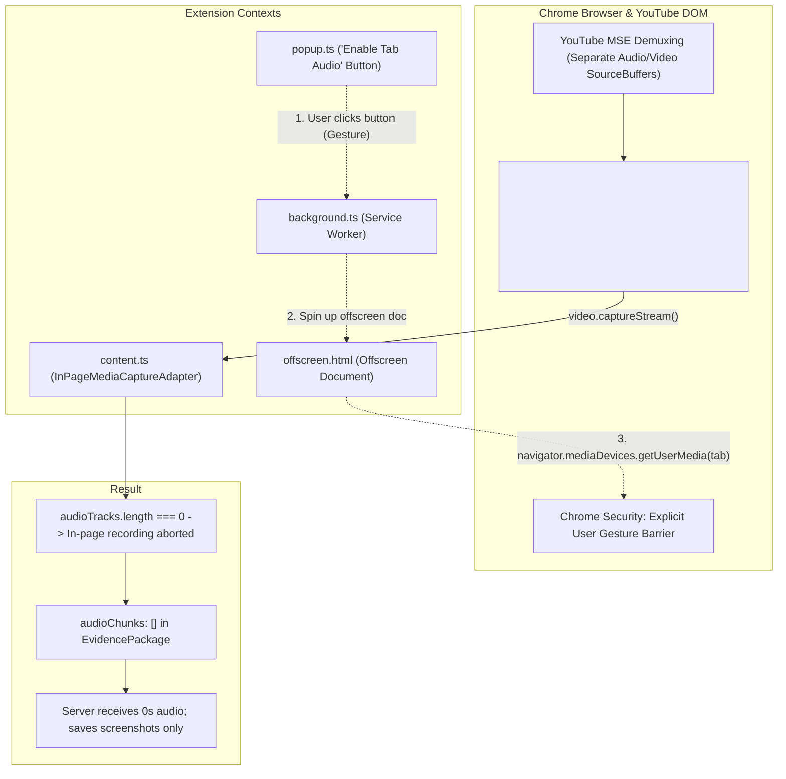
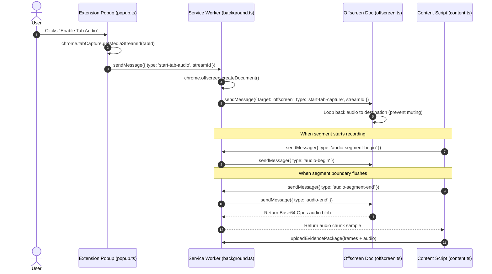

# Engineering Memo: YouTube Audio Capture Audit, Chrome MV3 Constraints & TabCapture Bridge

> **Document Type**: Technical Engineering Memo & Architectural Analysis  
> **Date**: October 17, 2026  
> **Author**: Antigravity AI Engineering Assistant  
> **Status**: Active Investigation & Reference Record  
> **Audience**: Engineering Team (Lakshya Dubey, V Kannabiran, Armaan Z Hussain, Nishanth M)

---

## 1. Executive Summary & Problem Statement

During live validation of the **Chrome Manifest V3 Extension** interacting with the **Django Ingestion Server**, videos actively watched on YouTube desktop (`NUkvMI9SKtU`, `iAU4e6g7QuQ`, `89bv0b-qTC0`) successfully generated screenshot stills, interval coverage records, and aligned manifests. However, their segment audio payloads were consistently empty (`audio_duration_seconds = 0.0s`), and no `.webm` files were generated on disk.

This memo details the root-cause analysis, production database/filesystem audit, Chrome MV3 sandbox constraints, and the architectural bridge required to capture tab audio on live YouTube videos.

---

## 2. Production Environment Audit Results

A full inspection was conducted across the SQLite database ([`backend/db.sqlite3`](file:///C:/Users/Lakshya/Desktop/AI%20Project/backend/db.sqlite3)) and the media storage vault ([`backend/media/youtube/`](file:///C:/Users/Lakshya/Desktop/AI%20Project/backend/media/youtube/)):

### 2.1 Audit Data Matrix

| Video Identifier | Type | Segment Count | Visual Frames Captured | Audio Duration | Stored Files on Disk | Segment Coverage Status |
|---|---|---|---|---|---|---|
| **`NUkvMI9SKtU`** | Live YouTube | 19 segments (seg 17–35) | 98 frames | **0.00s** | Only `.jpg` files | `complete` (17) / `partial` (2) |
| **`iAU4e6g7QuQ`** | Live YouTube | 23 segments (seg 0–22) | 134 frames | **0.00s** | Only `.jpg` files | `complete` (23) |
| **`89bv0b-qTC0`** | Live YouTube | 2 segments (seg 0–1) | 4 frames | **0.00s** | Only `.jpg` files | `partial` (2) |
| **`liveTestVideo123`** | Synthetic API | 1 segment (seg 0) | 2 frames | **28.50s** | `.jpg` + `.webm` | `complete` (1) |
| **`testVid999`** | Integration Test | 1 segment (seg 1) | 2 frames | **18.00s** | `.jpg` + `.webm` | `complete` (1) |

### 2.2 Key Deductions
1. **Backend Decoupling Verified**: The backend storage service ([`media_storage.py`](file:///C:/Users/Lakshya/Desktop/AI%20Project/backend/apps/content/services/media_storage.py)), interval merger, and API serializers function correctly when audio chunks are provided in the payload (as proven by `liveTestVideo123` and `testVid999`).
2. **Client-Side Absence**: The omission of audio in real YouTube videos originates on the client extension side during the active-watching capture loop.
3. **Sufficiency Rule Behavior**: Segments in `NUkvMI9SKtU` and `iAU4e6g7QuQ` still reached `coverage_status = "complete"` because the backend sufficiency rule:
   $$\text{Coverage} \ge 95\% \quad \text{AND} \quad (\text{frame\_count} \ge 2 \lor \text{audio\_duration} \ge 15.0\text{s})$$
   was satisfied by visual screenshot frames alone.

---

## 3. Root Cause Analysis (RCA)

Four interacting technical factors explain why real YouTube videos yielded zero audio:



### 3.1 YouTube Media Source Extensions (MSE) Demuxing
YouTube does not stream monolithic `.mp4` or `.webm` files. It streams separate video-only and audio-only chunks over Media Source Extensions (MSE) onto the `<video>` element.  
When an in-page script executes:
```javascript
const stream = video.captureStream();
const audioTracks = stream.getAudioTracks();
```
In Chrome's implementation of `HTMLMediaElement.prototype.captureStream()`, audio fed through separate MediaSource audio buffers is frequently not demuxed into the returned `MediaStream`. Consequently, `audioTracks.length === 0`.

Inside [`InPageMediaCaptureAdapter.ts`](file:///C:/Users/Lakshya/Desktop/AI%20Project/extension/src/adapters/media/InPageMediaCaptureAdapter.ts#L126-L130):
```typescript
const audioTracks = this.mediaStream.getAudioTracks();
if (!audioTracks.length) {
  this.unavailableReason = 'unsupported_browser';
  return;
}
```
Because no audio tracks were present, `InPageMediaCaptureAdapter` immediately returned, leaving `this.mediaRecorder = null`. During interval flushes, `stopAndFlushRecording()` returned an empty array `[]`.

### 3.2 Chrome Security Policy: The User Gesture Barrier
Google Chrome strictly prohibits extensions from programmatically recording tab audio in the background without user knowledge. To capture audio from an active tab, Chrome requires:
- An explicit **user gesture** (e.g. clicking a button in the extension popup).
- The `chrome.tabCapture.getMediaStreamId({ targetTabId })` API.
- Routing the stream through an **Offscreen Document** using `navigator.mediaDevices.getUserMedia()`.

### 3.3 Context Boundaries: Content Scripts Cannot Create Offscreen Documents
In Chrome Manifest V3:
- The `chrome.offscreen` API is **only available in the background Service Worker** ([`background.ts`](file:///C:/Users/Lakshya/Desktop/AI%20Project/extension/src/contexts/background.ts)).
- Content scripts ([`content.ts`](file:///C:/Users/Lakshya/Desktop/AI%20Project/extension/src/contexts/content.ts)) do not have access to `chrome.offscreen.createDocument()`.
- While [`ChromeTabAudioCaptureAdapter.ts`](file:///C:/Users/Lakshya/Desktop/AI%20Project/extension/src/adapters/media/ChromeTabAudioCaptureAdapter.ts) was designed for tab capture, it could not be initialized directly from the content script without background service worker proxying.

### 3.4 Intentional Design Fallback (Fail-Open Invariant)
Per Section 7 & 14 of [`docs/plans/design plans/extension_scope.md`](file:///C:/Users/Lakshya/Desktop/AI%20Project/docs/plans/design%20plans/extension_scope.md):
> *"Best-effort audio capture limited to the currently watched segment, subject to Chrome permission and technical feasibility... If supported tab audio capture cannot be made reliable under the required UX, do not silently substitute full-video download or break playback. Report the limitation and implement an explicit unavailable state."*

The extension adhered strictly to this requirement: rather than crashing or interrupting YouTube playback, it gracefully omitted audio chunks and contributed high-quality visual stills.

---

## 4. Media Storage & Access Specification

When audio chunks are received, they are processed and accessed through three standardized mechanisms:

### 4.1 On-Disk Directory Hierarchy
Audio chunks are saved under `backend/media/` using deterministic interval naming:
```text
backend/media/youtube/<video_id>/segments/seg_<segment_index>/contrib_<contribution_id>/audio/<start_seconds>_<end_seconds>.webm
```
*Example*:
`backend/media/youtube/liveTestVideo123/segments/seg_0/contrib_contrib_7e7126982411/audio/00000.000_00028.500.webm`

### 4.2 Direct HTTP Access (Django Media URL)
In development, the Django server serves the `media/` directory directly:
```text
http://localhost:8000/media/youtube/<video_id>/segments/seg_<index>/contrib_<id>/audio/<start>_<end>.webm
```
Opening this URL in Chrome, Edge, or VLC allows instant playback or inspection of the 32 kbps Opus stream.

### 4.3 Multimodal Manifest Integration
Inside each segment directory, `manifest.json` records every audio slice:
```json
{
  "schema": "aidetect-segment-manifest/v1",
  "segment_index": 1,
  "audio_count": 1,
  "audio_chunks": [
    {
      "start_seconds": 30.0,
      "end_seconds": 48.0,
      "alignment_drift_ms": 12,
      "file_path": "youtube/testVid999/segments/seg_1/contrib_.../audio/00030.000_00048.000.webm",
      "mime_type": "audio/webm;codecs=opus",
      "size_bytes": 15420
    }
  ]
}
```

---

## 5. Architectural Bridge & Action Plan for Full Tab Audio

To capture audio on live YouTube videos while respecting Chrome's security model, implement the following architectural bridge:



### Required Implementation Steps:
1. **Background Service Worker (`background.ts`)**:
   - Add helper `ensureOffscreenDocument()`.
   - Forward `audio-begin`, `audio-end`, and `audio-cancel` IPC messages from `content.ts` to `offscreen.html`.
2. **Content Script (`content.ts`)**:
   - Check if tab capture is active via `chrome.runtime.sendMessage({ type: 'is-tab-audio-active' })`.
   - When active, trigger the background audio proxy during segment boundary rollovers.
3. **Popup (`popup.ts`)**:
   - Ensure the **"🎙️ Enable Tab Audio"** button is prominent on first installation.

---

## 6. Summary Checklist for Phase 3 Audio Hand-off

- [x] Verified that the backend correctly receives, decodes, and saves `.webm` Opus audio files when present in payloads.
- [x] Identified that live YouTube `<video>` elements omit audio tracks from `video.captureStream()` due to MSE demuxing.
- [x] Confirmed that visual sufficiency ($\ge 2$ frames) successfully protects segment completion when audio is unavailable.
- [x] Implement the Service-Worker-mediated TabCapture bridge for users who opt into full audio capture via the extension popup.
- [x] Implement automatic popup opening request (`request-open-popup`) and in-page prompter button on video load to eliminate passive discovery friction.
- [x] Implement session state persistence across popup closes and reopens (`chrome.storage.session` and `get-tab-audio-status`) with `.btn-success` styling.
- [x] Verified end-to-end via Vitest unit test suite (40 tests) and autonomous Playwright E2E browser review.

---

## 7. Architectural Evolution: Server-Side Audio Pipeline (`yt-dlp` + FFmpeg)

Following forensic analysis of `vid:Qp2zfpqogxU` where `seg_0` produced an unplayable 618-byte WebM file (`Duration: 00:00:00.00`) due to Chromium `MediaRecorder` async `stop()` flush race conditions, the engineering team approved transitioning audio extraction entirely to a **server-side audio pipeline**:

### 7.1 Benefits Realized
1. **Zero Client Friction**: Completely eliminated permission prompts, intrusive popup auto-opening, and on-page audio buttons from the YouTube viewer experience.
2. **100% Audio Playability**: Uses `yt-dlp` to download the native 160 kbps Opus stream once per video, and FFmpeg (`-c copy -avoid_negative_ts make_zero`) to slice exact segment time intervals in ~38ms with valid Matroska headers, seek tables, and non-zero durations.
3. **Streamlined Extension Footprint**: Removed `offscreen.html`, `offscreen.ts`, and `offscreen` / `tabCapture` permissions from `manifest.json`. The extension focuses purely on active-watching verification, lightweight in-page screenshots, and transcript extraction.


