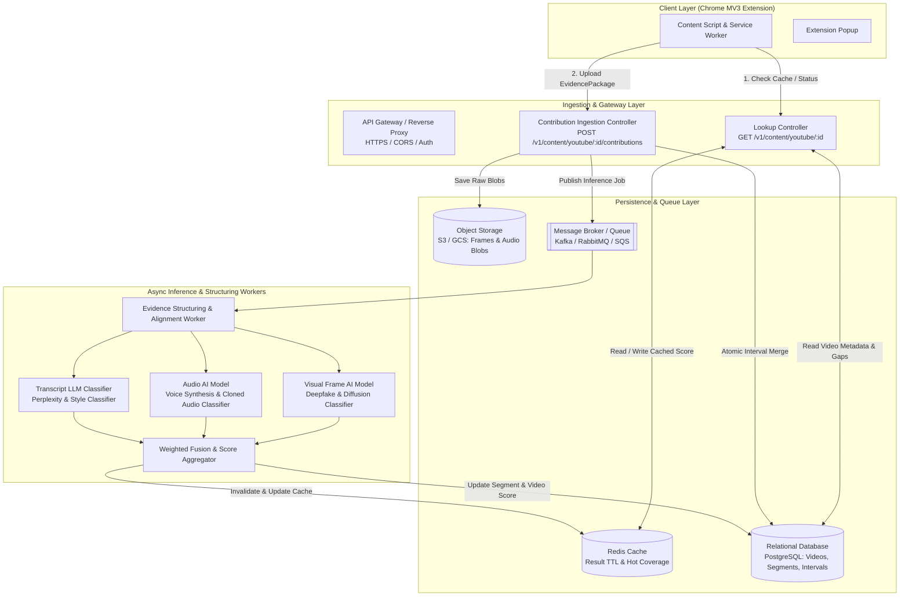
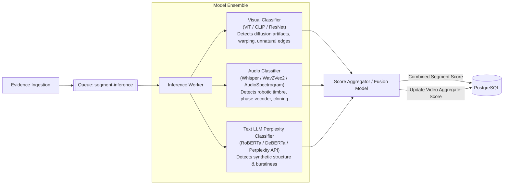

# Backend System Architecture & Integration Handoff
> **Specification for Building the Crowdsourced AI Content Detection Ingestion & Inference Backend**
> **Target Audience**: Backend Engineers, Systems Architects, and Incoming Agentic AI Sessions continuing the backend scope.

---

## 1. Executive Summary & System Context

This document provides the complete technical specification for receiving, structuring, and processing the crowdsourced multimodal evidence collected by the **YouTube AI-Content Detection Chrome MV3 Extension**.

The client extension acts as an active-watching collector:
- It tracks 30-second half-open video segments `[k*30, (k+1)*30)` on YouTube.
- When an active viewer watches an unmapped or partially covered video, it packages timestamped screenshot frames (JPEG), segment-scoped audio (WebM Opus), and accessible transcripts.
- It posts bounded `EvidencePackage` JSON payloads to the backend API.
- For all viewers, it queries `GET /v1/content/youtube/{video_id}` to retrieve cached classification results, AI-reliance scores (0.0 to 1.0), and missing segment indices.

### End-to-End System Diagram



---

## 2. Exhaustive API Contracts (HTTP REST)

The extension communicates via standard HTTPS REST endpoints. The base URL defaults to `https://api.aidetect-crowdsourced.org/v1` and is configurable in the client.

### 2.1 Endpoint 1: Video Lookup & Segment Coverage

* **Route**: `GET /v1/content/youtube/{video_id}`
* **Headers**:
  ```http
  Accept: application/json
  Authorization: Bearer <client_or_user_token> (Optional)
  ```
* **Parameters**:
  * `video_id` (Path, required): 11-character YouTube video ID (e.g. `dQw4w9WgXcQ`).

#### Response: Video Found (Partial or Complete)
* **Status**: `200 OK`
* **Content-Type**: `application/json`
* **Schema**:
```json
{
  "video_id": "dQw4w9WgXcQ",
  "status": "partial",
  "label": "UNKNOWN",
  "ai_reliance_score": null,
  "confidence": null,
  "segment_duration_seconds": 30,
  "segments": [
    {
      "index": 0,
      "start_seconds": 0,
      "end_seconds": 30,
      "coverage": "complete"
    },
    {
      "index": 1,
      "start_seconds": 30,
      "end_seconds": 60,
      "coverage": "partial"
    },
    {
      "index": 2,
      "start_seconds": 60,
      "end_seconds": 90,
      "coverage": "missing"
    }
  ],
  "missing_segment_indices": [1, 2],
  "analyzed_at": null,
  "required_policy_version": "v1"
}
```

#### Response: Video Found & Analysis Complete
* **Status**: `200 OK`
* **Schema**:
```json
{
  "video_id": "dQw4w9WgXcQ",
  "status": "complete",
  "label": "AI_GENERATED",
  "ai_reliance_score": 0.86,
  "confidence": 0.92,
  "segment_duration_seconds": 30,
  "segments": [
    {
      "index": 0,
      "start_seconds": 0,
      "end_seconds": 30,
      "coverage": "complete"
    },
    {
      "index": 1,
      "start_seconds": 30,
      "end_seconds": 60,
      "coverage": "complete"
    }
  ],
  "missing_segment_indices": [],
  "analyzed_at": "2026-10-16T18:00:00.000Z",
  "required_policy_version": "v1"
}
```

#### Response: Video Not Yet Mapped
* **Status**: `200 OK` (or `404 Not Found` with the same body; client handles both gracefully)
* **Schema**:
```json
{
  "video_id": "newVideo1234",
  "status": "not_found",
  "label": "UNKNOWN",
  "ai_reliance_score": null,
  "confidence": null,
  "segment_duration_seconds": 30,
  "segments": [],
  "missing_segment_indices": [],
  "analyzed_at": null,
  "required_policy_version": "v1"
}
```

---

### 2.2 Endpoint 2: Submit Evidence Contribution

* **Route**: `POST /v1/content/youtube/{video_id}/contributions`
* **Headers**:
  ```http
  Content-Type: application/json
  Accept: application/json
  Authorization: Bearer <token> (Optional)
  ```
* **Payload Size Limits**: Max 15 MB per request (typically 1–3 MB for 30s of JPEG stills and Opus audio).

#### Request Body Schema (Full Multimodal Package)
```json
{
  "video_id": "dQw4w9WgXcQ",
  "policy_version": "v1",
  "segment_index": 1,
  "segment_start_seconds": 30,
  "segment_end_seconds": 60,
  "observed_intervals": [
    {
      "start_seconds": 30.0,
      "end_seconds": 48.0
    }
  ],
  "frames": [
    {
      "video_timestamp_seconds": 35.0,
      "mime_type": "image/jpeg",
      "data": "/9j/4AAQSkZJRgABAQEASABIAAD...",
      "width": 1280,
      "height": 720
    },
    {
      "video_timestamp_seconds": 40.0,
      "mime_type": "image/jpeg",
      "data": "/9j/4AAQSkZJRgABAQEASABIAAD...",
      "width": 1280,
      "height": 720
    }
  ],
  "audio_chunks": [
    {
      "start_seconds": 30.0,
      "end_seconds": 48.0,
      "mime_type": "audio/webm;codecs=opus",
      "data": "GkXfo59ChoEBQveBAULygQRC84EIQoK...",
      "alignment_drift_ms": 12
    }
  ],
  "transcript": {
    "scope": "full",
    "language": "en",
    "segments": [
      {
        "start_seconds": 0.0,
        "end_seconds": 4.5,
        "text": "Welcome to this demonstration."
      },
      {
        "start_seconds": 4.5,
        "end_seconds": 8.0,
        "text": "Today we will analyze crowdsourced active watching."
      }
    ],
    "content_hash": "b94d27b9934d3e08a52e52d7da7dabfac484efe37a5380ee9088f7ace2efcde9",
    "omission_reason": null
  },
  "capabilities": {
    "screenshots": true,
    "tab_audio": true,
    "transcript_scope": "full",
    "audio_unavailable_reason": null
  }
}
```

#### Field Explanations & Invariants
| Field | Type | Description | Invariant Enforced |
|---|---|---|---|
| `video_id` | String | 11-char YouTube ID | Must match URL path param |
| `policy_version` | String | e.g. `"v1"` | Reject if outdated policy |
| `segment_index` | Integer | Segment index $k \ge 0$ | Segment bounds = $[k*30, (k+1)*30)$ |
| `observed_intervals` | Array | `[{start_seconds, end_seconds}]` | Half-open: $start < end$; must be clamped to segment bounds |
| `frames` | Array | Screenshot stills | Base64-encoded JPEG (max 1280px, quality ~0.75, ~150KB/frame) |
| `audio_chunks` | Array | Segment audio slices | Base64-encoded WebM Opus (32 kbps, strictly within observed interval) |
| `transcript` | Object / null | Full or partial cues | May be `null` if captions unavailable; deduplicated by `content_hash` |
| `capabilities` | Object | Client device flags | Reflects technical availability without fabricating missing tracks |

#### Success Response
* **Status**: `200 OK` (or `201 Created`)
* **Schema**:
```json
{
  "contribution_id": "contrib_98a7fbc2",
  "accepted_intervals": [
    {
      "start_seconds": 30.0,
      "end_seconds": 48.0
    }
  ],
  "remaining_intervals": [
    {
      "start_seconds": 48.0,
      "end_seconds": 60.0
    }
  ],
  "video_status": "partial"
}
```

#### Rate Limiting & Overload Response (Client respects this automatically)
* **Status**: `429 Too Many Requests`
* **Headers**: `Retry-After: 5`
* **Schema**:
```json
{
  "error": "rate_limit_exceeded",
  "message": "Too many uploads from this client. Please back off.",
  "retry_after_seconds": 5
}
```

---

## 3. Core Backend Algorithmic Requirements

### 3.1 Deterministic Half-Open Interval Merging Math

The extension relies on half-open interval math $[start, end)$ to ensure that viewers who watch partial segments never claim full-segment coverage. The backend must enforce the identical math atomically.

```typescript
// Canonical backend interval merge algorithm (Node.js / TypeScript)
interface Interval {
  start: number;
  end: number;
}

function mergeIntervals(existing: Interval[], newIntervals: Interval[], epsilon = 0.25): Interval[] {
  const combined = [...existing, ...newIntervals].sort((a, b) => a.start - b.start);
  if (combined.length === 0) return [];

  const merged: Interval[] = [combined[0]];
  for (let i = 1; i < combined.length; i++) {
    const prev = merged[merged.length - 1];
    const curr = combined[i];

    if (curr.start <= prev.end + epsilon) {
      prev.end = Math.max(prev.end, curr.end);
    } else {
      merged.push({ ...curr });
    }
  }
  return merged;
}
```

### 3.2 Segment Sufficiency Rule
A 30-second segment $[k*30, (k+1)*30)$ is marked `complete` only when:
$$\text{Coverage Ratio} = \frac{\sum \text{duration}(\text{merged\_intervals})}{30.0} \ge 0.95 \quad (95\%)$$
AND at least one modality of evidence is present:
- Minimum 2 visual frames OR
- Audio chunk covering $\ge 15$ seconds of the segment.

If $\text{Coverage Ratio} < 0.95$ and $\text{Coverage Ratio} > 0.0$, the segment is labeled `partial`.
If $\text{Coverage Ratio} == 0.0$, the segment is `missing`.

### 3.3 Transcript Deduplication
YouTube transcripts are video-wide. The client generates a Web Crypto SHA-256 hash (`content_hash`) of all cues.
- The backend should maintain a unique set of `transcript_hashes` per `video_id`.
- If a contribution arrives with a `content_hash` already in the database, the backend saves the metadata flag but skips redundant object-storage writes and transcript model re-evaluations.

---

## 4. Suggested Storage & Database Architecture

### 4.1 Relational Schema (PostgreSQL Recommended)

```sql
-- 1. Video Entity
CREATE TABLE videos (
    video_id VARCHAR(11) PRIMARY KEY,
    title TEXT,
    channel TEXT,
    duration_seconds NUMERIC(8, 2),
    segment_duration_seconds INTEGER DEFAULT 30,
    status VARCHAR(20) DEFAULT 'partial', -- 'not_found', 'partial', 'processing', 'complete'
    label VARCHAR(20) DEFAULT 'UNKNOWN',  -- 'AI_GENERATED', 'HUMAN_MADE', 'MIXED', 'UNKNOWN'
    ai_reliance_score NUMERIC(4, 3),      -- 0.000 to 1.000
    confidence NUMERIC(4, 3),             -- 0.000 to 1.000
    analyzed_at TIMESTAMPTZ,
    created_at TIMESTAMPTZ DEFAULT NOW(),
    updated_at TIMESTAMPTZ DEFAULT NOW()
);

-- 2. Segments
CREATE TABLE video_segments (
    id SERIAL PRIMARY KEY,
    video_id VARCHAR(11) REFERENCES videos(video_id) ON DELETE CASCADE,
    segment_index INTEGER NOT NULL,
    start_seconds NUMERIC(8, 3) NOT NULL,
    end_seconds NUMERIC(8, 3) NOT NULL,
    coverage_status VARCHAR(20) DEFAULT 'missing', -- 'missing', 'partial', 'complete'
    ai_segment_score NUMERIC(4, 3),
    UNIQUE(video_id, segment_index)
);

-- 3. Accepted Observed Intervals (Merged sub-slices)
CREATE TABLE segment_intervals (
    id SERIAL PRIMARY KEY,
    segment_id INTEGER REFERENCES video_segments(id) ON DELETE CASCADE,
    start_seconds NUMERIC(8, 3) NOT NULL,
    end_seconds NUMERIC(8, 3) NOT NULL
);

-- 4. Raw Contributions Log
CREATE TABLE contributions (
    contribution_id VARCHAR(36) PRIMARY KEY,
    video_id VARCHAR(11) REFERENCES videos(video_id),
    segment_index INTEGER NOT NULL,
    policy_version VARCHAR(10) NOT NULL,
    frame_count INTEGER DEFAULT 0,
    audio_duration_seconds NUMERIC(6, 2) DEFAULT 0,
    transcript_scope VARCHAR(20),
    transcript_hash VARCHAR(64),
    created_at TIMESTAMPTZ DEFAULT NOW()
);

-- 5. Full Transcripts (Deduplicated)
CREATE TABLE video_transcripts (
    content_hash VARCHAR(64) PRIMARY KEY,
    video_id VARCHAR(11) REFERENCES videos(video_id),
    language VARCHAR(10),
    scope VARCHAR(20),
    cues_json JSONB,
    created_at TIMESTAMPTZ DEFAULT NOW()
);
```

### 4.2 Object Storage Organization (S3 / GCS)
Store binary assets in cloud object storage; never store raw binary in the database:
```
s3://aidetect-evidence-vault/
└── youtube/
    └── {video_id}/
        └── seg_{segment_index}/
            ├── contrib_{contribution_id}/
            │   ├── frame_00035.000.jpg
            │   ├── frame_00040.000.jpg
            │   └── audio_30.000_48.000.webm
```

---

## 5. Multimodal AI Inference Pipeline Design

When a segment reaches sufficient coverage, or when an evidence package arrives, the ingestion service pushes an inference job onto a background message queue (e.g. SQS / RabbitMQ / Celery).



### 5.1 Weighted Modality Fusion
When all available modalities are evaluated, the segment AI reliance score $S_{\text{seg}}$ is computed via weighted fusion:
$$S_{\text{seg}} = w_v \cdot S_{\text{visual}} + w_a \cdot S_{\text{audio}} + w_t \cdot S_{\text{text}}$$
* Recommended default weights:
  * Visual ($w_v$): `0.45`
  * Audio ($w_a$): `0.35`
  * Transcript / Text ($w_t$): `0.20`
* If a modality is unavailable (e.g. video has no speech or audio is missing), normalize remaining weights so $\sum w_i = 1.0$.

### 5.2 Whole-Video Aggregation
The overall video AI Reliance Score $S_{\text{video}}$ is the time-weighted average across all completed segments:
$$S_{\text{video}} = \frac{\sum_{k} \text{duration}(k) \cdot S_{\text{seg}}(k)}{\sum_k \text{duration}(k)}$$
* **Thresholds for Client Badges & Filtering**:
  * $S_{\text{video}} \ge 0.70 \implies \text{label: 'AI\_GENERATED'}$ (Triggers badge warning and opt-in hide filter)
  * $0.35 \le S_{\text{video}} < 0.70 \implies \text{label: 'MIXED'}$
  * $S_{\text{video}} < 0.35 \implies \text{label: 'HUMAN\_MADE'}$

---

## 6. How to Connect the Chrome Extension to Your New Backend

The Chrome extension currently ships with `MockBackendApiAdapter` active for local testing. To connect the extension to your production or staging backend:

1. **Open `src/contexts/background.ts`**:
   Change line 8:
   ```typescript
   // Set to false to enable production HTTP backend adapter
   const USE_MOCK_BACKEND = false;
   ```
2. **Configure your API Base URL in `src/adapters/http/HttpBackendApiAdapter.ts`**:
   ```typescript
   export const DEFAULT_HTTP_BACKEND_CONFIG: HttpBackendConfig = {
     baseUrl: 'https://your-backend-api.domain.com/v1',
     authToken: 'optional_shared_secret_or_jwt',
     maxRetries: 3,
     initialRetryDelayMs: 500,
   };
   ```
3. **CORS Configuration on Backend**:
   Your backend API Gateway must allow requests from Chrome extensions:
   ```http
   Access-Control-Allow-Origin: *
   Access-Control-Allow-Methods: GET, POST, OPTIONS
   Access-Control-Allow-Headers: Content-Type, Authorization, Accept
   Access-Control-Expose-Headers: Retry-After
   ```
4. **Rebuild the extension**:
   ```bash
   npm run build
   ```
   Reload the extension in `chrome://extensions` via the Reload button.

---

## 7. Actionable Roadmap & Checklist for the Incoming Backend AI Agent

An agentic AI session tasked with implementing this backend should proceed through the following milestones:

- [ ] **Milestone B1: Ingestion API Service Setup**
  - Implement FastAPI / Express / Go HTTP router matching the exact JSON schemas for `GET /v1/content/youtube/{video_id}` and `POST /v1/content/youtube/{video_id}/contributions`.
  - Add CORS support and payload size limits (15 MB).
- [ ] **Milestone B2: Persistence & Interval Merging Layer**
  - Setup PostgreSQL tables (`videos`, `video_segments`, `segment_intervals`, `contributions`, `video_transcripts`).
  - Implement atomic half-open interval merging math and segment sufficiency ratio calculation ($\ge 0.95$).
- [ ] **Milestone B3: Object Storage & Transcript Deduplication**
  - Configure S3 / GCS bucket for decoded JPEG frames and Opus WebM audio chunks.
  - Implement SHA-256 transcript deduplication.
- [ ] **Milestone B4: Asynchronous Queue & Worker Pipeline**
  - Setup message queue (SQS, RabbitMQ, or Redis Streams).
  - Create worker consumer to ingest contribution jobs without blocking the HTTP response.
- [ ] **Milestone B5: Multimodal Inference Integration**
  - Connect frame classifiers (e.g. CLIP / Deepfake detector), voice synthesis detectors, and transcript perplexity analyzers.
  - Implement weighted fusion score calculation.
- [ ] **Milestone B6: Redis Caching & End-to-End Verification**
  - Cache lookup responses in Redis with 24h TTL; invalidate on new score calculation.
  - Connect real Chrome extension and test live active-watching contribution and score retrieval.
