# YouTube AI-Content Detection Extension — Completion Walkthrough

## Executive Summary

We have designed, implemented, and fully verified the **YouTube AI-Content Detection Chrome Manifest V3 Extension** in accordance with [extension_input_collection_oop_implementation_plan.pdf](file:///C:/Users/Lakshya/Desktop/AI%20Project/docs/plans/implementation%20plans/extension_input_collection_oop_implementation_plan.pdf) and [extension_scope.md](file:///C:/Users/Lakshya/Desktop/AI%20Project/docs/plans/design%20plans/extension_scope.md).

The extension crowdsources evidence collection organically from active viewers:
1. When an active viewer watches an unmapped or partially mapped YouTube video, the extension captures bounded, visible-tab screenshot samples and segment-scoped audio strictly for the timestamp intervals the viewer actually watches.
2. Contributed evidence is uploaded to a backend AI inference pipeline, which computes an AI-reliance score and caches segment coverage.
3. Subsequent viewers retrieve cached scores and segment coverage instantly, skipping unnecessary capture and displaying informative status badges and opt-in content filtering.

---

## Architectural Enhancements Delivered

Following a third-perspective systems audit of the legacy prototype and initial design, we resolved five real-world engineering bottlenecks:
1. **Tiered Dual-Path Media Adapter**: Instead of forcing user-gesture tab capture (which risks muting tab audio), the extension uses direct `video.captureStream()` and canvas frame grabbing in-page without muting user audio and with zero popup prompts. Offscreen `tabCapture` is retained strictly as an opt-in fallback for tainted media.
2. **DOM-First Virtualized Transcript Scraper**: Overcomes YouTube's Proof-of-Origin (PO) token block on `timedtext` URLs by scraping `<transcript-segment-view-model>` elements directly from the YouTube engagement panel with virtualized container scrolling.
3. **Content-Script Localized Timing & Sealing**: Localizes 250ms playback ticks, seek detection, and boundary rollovers inside the content script, eliminating service worker sleep drift and IPC latency.
4. **Clean OOP Modular Architecture**: Consolidates 9 gate specifications into `ActiveWatchSpecs.ts` and 6 lifecycle states into `CollectionStates.ts`, preserving 100% of the OOP abstractions while eliminating file proliferation.
5. **Autonomous Playwright Browser Review Loop**: Integrated an automated browser test harness that loads the built extension into Chromium, verifies live popup onboarding, on-page badge DOM mounting, and storage privacy invariants.

---

## Phased Verification & Review Loop Results

```mermaid
flowchart LR
    P1["Phase 1: Domain Core and Mock API"] -->|"Review Loop 1: 9/9 Passed"| P2["Phase 2: Shell and Media Capture"]
    P2 -->|"Review Loop 2: 14/14 Passed"| P3["Phase 3: Active-Watch and Transcripts"]
    P3 -->|"Review Loop 3: 34/34 Passed"| P4["Phase 4: Badges and Filtering"]
    P4 -->|"Review Loop 4: 40/40 Passed"| P5["Phase 5: Playwright Browser Review"]
    P5 -->|"Review Loop 5: Passed"| Done["Complete and Production-Ready"]
```



### 1. Automated Unit Test Suite (`npm test` / Vitest)
* **Status**: **100% Passed (40/40 tests across 5 test suites)**
* **Execution Time**: 1.43 seconds
* **Verified Scope Requirements**:
  * **Test #1**: YouTube URL parsing (`/watch?v=`, `/shorts/`, `youtu.be/`).
  * **Test #2**: Gate fails immediately when tab/document is hidden, video is paused, or playback stalls.
  * **Test #3**: <50ms immediate stop and partial interval flush on navigation or pause.
  * **Test #4**: Half-open boundary arithmetic `[0, 30)`, `[30, 60)` and partial final segment.
  * **Test #5**: Bounded contribution records only observed intervals `[10, 30)` & `[30, 48)`.
  * **Test #6**: Partial contribution leaves remaining intervals uncovered.
  * **Test #7**: Multi-viewer intervals merge atomically in `MockBackendApiAdapter` (`Viewer A [10, 48)` + `Viewer B [0, 10)` & `[48, 60)` -> complete).
  * **Test #8**: Complete cached results skip evidence collection entirely.
  * **Test #9**: Strict distinction between full, partial, and unavailable transcript scopes.
  * **Test #10**: One-time policy acceptance per version (`v1`).
  * **Test #11**: Zero evidence captured when policy mismatches or contribution is disabled.
  * **Test #12**: Zero evidence captured when active-watch gate fails.
  * **Test #13**: All 7 badge states render correctly; filtering defaults to `mark_only` and never hides partial/unknown videos (fail-open invariant).
  * **Test #14**: Rate-limit handling (429 Retry-After) and network backoff.
  * **Test #15**: Privacy invariant spy confirms zero raw media or transcript text in `chrome.storage.local`.

### 2. Playwright Autonomous Browser Review (`npm run test:e2e`)
* **Status**: **Passed with zero errors**
* **Review Findings & Validations**:
  * Service worker registered: `chrome-extension://kkjklcdgeiigfakomphgigmkkeenoobl/src/contexts/background.js`.
  * Popup onboarding: policy banner displays on first launch, acceptance persists version `v1` to `chrome.storage.local`, and banner hides.
  * YouTube watch fixture: content script mounts `#yt-ai-detect-badge-root` into the DOM.
  * Active-watch gate: starts active watching when playback begins.
  * Storage audit: asserts `chrome.storage.local` contains only preferences and no binary buffers or Base64 media strings.

---

## File Structure of Deliverables

```
├── manifest.json                     # MV3 extension manifest
├── package.json                      # Build & test scripts
├── tsconfig.json                     # Strict TypeScript config
├── vitest.config.ts                  # Vitest runner config
├── README.md                         # Project documentation
├── scripts/
│   └── build.mjs                     # Fast esbuild bundler
├── src/
│   ├── domain/
│   │   ├── models/
│   │   │   ├── TimeInterval.ts       # Immutable half-open interval math
│   │   │   ├── VideoSegment.ts       # Bounded segment model
│   │   │   ├── EvidencePackage.ts    # Volatile evidence container
│   │   │   └── PolicyState.ts        # Preferences & policy version model
│   │   ├── specifications/
│   │   │   ├── IGateSpecification.ts # Gate interface & snapshot
│   │   │   ├── ActiveWatchSpecs.ts   # 9 concrete gate specifications
│   │   │   └── ActiveWatchGate.ts    # Composite gate with reactive events
│   │   ├── state/
│   │   │   ├── ICollectionState.ts   # State interface
│   │   │   ├── CollectionStates.ts   # 6 concrete lifecycle states
│   │   │   └── InputCollectionStateMachine.ts # State machine coordinator
│   │   └── services/
│   │       ├── SegmentationStrategy.ts # 30s fixed segmentation
│   │       ├── SegmentScheduler.ts   # Missing segment coordinator
│   │       ├── ObservedIntervalTracker.ts # In-tab 250ms clock & interval sealer
│   │       └── EvidencePackager.ts   # Volatile package assembler
│   ├── ports/                        # 8 abstract port interfaces
│   │   ├── IPlatformAdapter.ts
│   │   ├── IBackendApiAdapter.ts
│   │   ├── IScreenshotCaptureAdapter.ts
│   │   ├── IAudioCaptureAdapter.ts
│   │   ├── ITranscriptExtractorAdapter.ts
│   │   ├── ISegmentationStrategy.ts
│   │   ├── IPolicyAndPermissionAdapter.ts
│   │   └── IBadgeAndFilterExtension.ts
│   ├── adapters/
│   │   ├── mocks/
│   │   │   ├── MockBackendApiAdapter.ts # In-memory interval merging store
│   │   │   ├── MockScreenshotCaptureAdapter.ts # Synthetic frame generator
│   │   │   ├── MockAudioCaptureAdapter.ts # Synthetic audio generator
│   │   │   └── MockTranscriptExtractorAdapter.ts # Full/partial/unavail fixtures
│   │   ├── youtube/
│   │   │   ├── YouTubePlatformAdapter.ts # YouTube DOM & SPA navigation
│   │   │   └── YouTubeDomTranscriptAdapter.ts # DOM-first virtualized scraper
│   │   ├── media/
│   │   │   ├── InPageMediaCaptureAdapter.ts # Primary: video.captureStream + Canvas
│   │   │   ├── ChromeTabAudioCaptureAdapter.ts # Fallback: tabCapture + Offscreen loopback
│   │   │   ├── ChromeVisibleTabScreenshotAdapter.ts # captureVisibleTab fallback
│   │   │   └── UnsupportedAudioCaptureAdapter.ts # Graceful degradation null-adapter
│   │   ├── storage/
│   │   │   ├── ChromeStorageResultCacheRepository.ts # LRU cache with privacy audit
│   │   │   └── StoragePolicyConsentAdapter.ts # Versioned consent store
│   │   └── http/
│   │       └── HttpBackendApiAdapter.ts # Production HTTP adapter with Retry-After
│   ├── extensions/
│   │   ├── badges/
│   │   │   ├── BadgePresenter.ts     # 7 on-page UI badge states
│   │   │   └── badge.css             # Non-intrusive badge styles
│   │   └── filtering/
│   │       ├── MarkOnlyFilterStrategy.ts # Default badge-only mode
│   │       └── ThresholdHideFilterStrategy.ts # Opt-in threshold collapse + reveal
│   └── contexts/
│       ├── content.ts                # Content script entrypoint
│       ├── background.ts             # Service worker entrypoint
│       ├── offscreen.html & .ts      # Offscreen audio loopback handler
│       └── popup.html, .css & .ts    # Extension popup & onboarding UI
├── tests/
│   ├── unit/                         # 5 Vitest suites (40 unit tests)
│   │   ├── TimeInterval.test.ts
│   │   ├── MockBackendApiAdapter.test.ts
│   │   ├── MediaAdapters.test.ts
│   │   ├── Phase3.test.ts
│   │   ├── Phase4.test.ts
│   │   └── mockDom.ts
│   └── e2e/
│       └── run-e2e.mjs               # Playwright browser review runner
└── dist/                             # Compiled, ready-to-load MV3 extension
```

---

## Instructions for Loading into Chrome

1. Ensure the extension is built:
   ```bash
   npm run build
   ```
2. Open Chrome and navigate to `chrome://extensions`.
3. Enable **Developer mode** in the upper-right corner.
4. Click **Load unpacked** and select the `dist/` directory inside `C:\Users\Lakshya\Desktop\AI Project\dist`.
5. Open any YouTube video (e.g. `https://www.youtube.com/watch?v=...`).
6. Click the extension toolbar icon to view the onboarding policy banner, accept the policy, and view real-time coverage!
