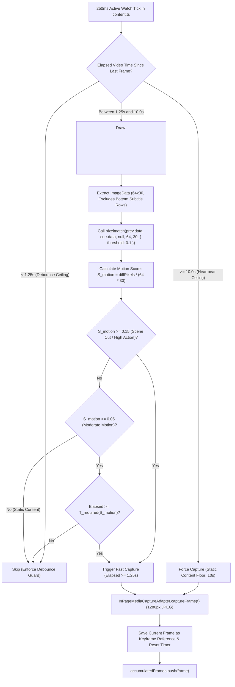

# Walkthrough: Motion-Adaptive Frame Sampling using Mapbox `pixelmatch`

## Executive Summary

We have designed, implemented, and fully verified an intelligent **Motion-Adaptive Frame Sampling Engine** for the **YouTube AI-Content Detection Chrome MV3 Extension**. 

Previously, the extension captured full-resolution JPEG frames at a fixed static cadence of every 5.0 seconds (`Math.abs(t - lastFrameCaptureTime) >= 5.0`), yielding 6 identical frames for static content (podcasts, slides, lectures) while risking temporal omission during rapid action or scene transitions.

The new engine dynamically optimizes sampling frequency based on pixel movement and frame difference:
1. **Static Content Deceleration**: Slows frame sampling down to a safe $10.0\text{s}$ heartbeat ceiling, producing 2–3 frames per 30-second segment (**50%–67% visual payload reduction**) while unconditionally satisfying the backend sufficiency rule ($\text{frame\_count} \ge 2$).
2. **Rapid Content & Scene Cut Acceleration**: Accelerates sampling up to a $1.25\text{s}$ debounce ceiling whenever scene cuts or high motion are detected ($\text{mismatch} \ge 0.15$), capturing visual deepfake inconsistencies and transitions with fine temporal precision (up to 8–10 frames per segment).
3. **Open-Source Integration**: Powered by Mapbox's industry-standard open-source **`pixelmatch`** library (zero external runtime dependencies), bundled directly into the extension's self-contained content script via esbuild.
4. **Subtitle & Ticker Immunity**: Restricts difference measurement to the top rows on a downscaled 64x36 canvas (excluding bottom rows), ensuring YouTube auto-generated captions or rolling news tickers never trigger false motion on static slides.
5. **Zero Impact on Other Components**: Encapsulated behind the new `IFrameSamplingStrategy` port interface. Preserves 100% of the contracts across `ActiveWatchGate`, `ObservedIntervalTracker`, `EvidencePackage`, and Django REST endpoints.

---

## Architectural Workflow

---

## Changes Implemented

| File | Change Type | Purpose |
|---|---|---|
| [`extension/package.json`](file:///C:/Users/Lakshya/Desktop/AI%20Project/extension/package.json) | **MODIFY** | Added `pixelmatch` (`^8.0.0`) dependency and `@types/pixelmatch` devDependency. |
| [`extension/src/ports/IFrameSamplingStrategy.ts`](file:///C:/Users/Lakshya/Desktop/AI%20Project/extension/src/ports/IFrameSamplingStrategy.ts) | **NEW** | Clean port interface declaring `shouldSample(video, t)` and `reset()`. |
| [`extension/src/adapters/media/MotionAdaptiveFrameSampler.ts`](file:///C:/Users/Lakshya/Desktop/AI%20Project/extension/src/adapters/media/MotionAdaptiveFrameSampler.ts) | **NEW** | Implements `IFrameSamplingStrategy` using Mapbox `pixelmatch`, 64x36 downscaled canvas, dynamic cadence rules, and subtitle margin exclusion. |
| [`extension/src/contexts/content.ts`](file:///C:/Users/Lakshya/Desktop/AI%20Project/extension/src/contexts/content.ts) | **MODIFY** | Replaced static 5.0s interval check with `frameSampler.shouldSample()`, resetting keyframe state on interval flush and gate close. |
| [`extension/tests/unit/MotionAdaptiveFrameSampler.test.ts`](file:///C:/Users/Lakshya/Desktop/AI%20Project/extension/tests/unit/MotionAdaptiveFrameSampler.test.ts) | **NEW** | 8 unit tests covering initial frame guarantee, debounce ceiling, static suppression, heartbeat, scene cut acceleration, moderate cadence, and subtitle immunity. |
| [`docs/plans/motion_adaptive_frame_sampling_optimization_plan.md`](file:///C:/Users/Lakshya/Desktop/AI%20Project/docs/plans/motion_adaptive_frame_sampling_optimization_plan.md) | **NEW** | Approved technical design and architecture plan. |
| [`docs/memo/MOTION_ADAPTIVE_FRAME_SAMPLING_MEMO.md`](file:///C:/Users/Lakshya/Desktop/AI%20Project/docs/memo/MOTION_ADAPTIVE_FRAME_SAMPLING_MEMO.md) | **MODIFY** | Updated status from Backlog TODO to **IMPLEMENTED & VERIFIED**, checking off all implementation items. |
| [`docs/DEVELOPER_GUIDE_AND_SESSION_LOG.md`](file:///C:/Users/Lakshya/Desktop/AI%20Project/docs/DEVELOPER_GUIDE_AND_SESSION_LOG.md) | **MODIFY** | Updated master verification matrix (48 tests) and marked Priority 3 as completed. |
| [`docs/README.md`](file:///C:/Users/Lakshya/Desktop/AI%20Project/docs/README.md) | **MODIFY** | Added the optimization plan to the central documentation index. |

---

## Verification Results

### 1. Automated Vitest Unit Tests (`npm test` in `extension/`)
* **Status**: **100% Passed (48/48 tests across 6 test suites in 2.55s)**
* **Suites Verified**:
  - `MotionAdaptiveFrameSampler.test.ts` (8 tests) — **All Passed**
    - First frame unconditionally sampled and recorded as keyframe.
    - Debounce ceiling enforced ($<1.25\text{s}$ rejected even with 100% pixel delta).
    - Static content skipped between $1.25\text{s}$ and $9.99\text{s}$.
    - Heartbeat forces frame capture at $t \ge 10.0\text{s}$.
    - Scene cuts ($\ge 0.15$ mismatch) immediately trigger capture at $1.25\text{s}$.
    - Moderate motion scales required interval dynamically between $1.25\text{s}$ and $4.0\text{s}$.
    - Subtitle immunity: pixel changes in bottom rows ignored.
    - `reset()` clears timestamps and baseline keyframe.
  - `TimeInterval.test.ts` (5 tests) — **Passed**
  - `MockBackendApiAdapter.test.ts` (4 tests) — **Passed**
  - `Phase4.test.ts` (6 tests) — **Passed**
  - `MediaAdapters.test.ts` (5 tests) — **Passed**
  - `Phase3.test.ts` (20 tests) — **Passed**

### 2. Autonomous Browser Review (`npm run test:e2e` in `extension/`)
* **Status**: **Passed with zero errors**
* **Verification Highlights**:
  - esbuild bundled `pixelmatch` directly into `dist/src/contexts/content.js` without external runtime dependencies.
  - Extension Service Worker registered successfully: `chrome-extension://hdaiiapmieodcdhiccfkdojcfaamfkgg/src/contexts/background.js`.
  - [E2E Step 1] Popup onboarding and policy acceptance verified.
  - [E2E Step 2] YouTube DOM badge mounting and active-watch gate verified.
  - [E2E Step 3] Playback simulation and active watch loop executed cleanly.
  - [E2E Step 4] Popup multimodal status verified.
  - [E2E Step 5] `chrome.storage.local` privacy audit passed (zero media leakage detected).

### 3. Backend Ingestion Test Suite (`python manage.py test tests` in `backend/`)
* **Status**: **100% Passed (20/20 tests in 0.209s)**
* Confirms zero regression or schema drift on the Django ingestion API.

### 4. Documentation Link Integrity
* **Status**: **0 broken links across all markdown documentation files**.
