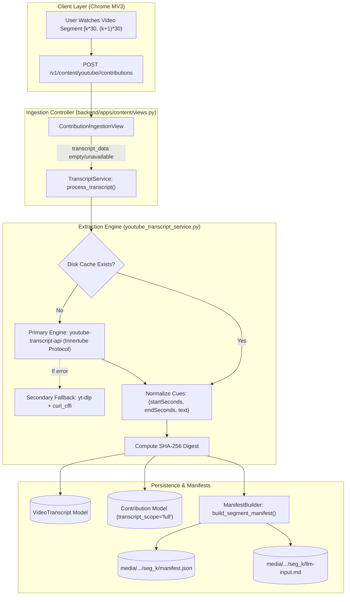

# Technical Memo: Server-Side YouTube Caption & Transcript Extraction Pipeline

> **Author**: Engineering Team / Pair-Programming Session  
> **Date**: October 19, 2026  
> **Target Subsystems**: `backend/apps/content/services/`, `backend/apps/content/views.py`, `backend/media/`  
> **Related Memos**: [`AUDIO_CAPTURE_ANALYSIS_AND_MEMO.md`](file:///C:/Users/Lakshya/Desktop/AI%20Project/docs/memo/AUDIO_CAPTURE_ANALYSIS_AND_MEMO.md), [`BACKEND_ARCHITECTURE_AND_HANDOFF.md`](file:///C:/Users/Lakshya/Desktop/AI%20Project/docs/memo/BACKEND_ARCHITECTURE_AND_HANDOFF.md)

---

## 1. Executive Summary & Forensic Audit

During operational inspection of live YouTube video ingestion (`y2rPvroMk-8`, `Qp2zfpqogxU`, `jkSiTjRAjVQ`, `iLOHNwIkyso`, `iAU4e6g7QuQ`, `NUkvMI9SKtU`, `89bv0b-qTC0`), an exhaustive database and media vault audit revealed:

* **100% Failure Rate in Client Caption Collection**: All 157 recorded contributions stored `transcript_scope: 'unavailable'` and `transcript_hash: ''`.
* **Zero Database Transcripts**: `VideoTranscript.objects.count()` was strictly `0`.
* **Empty Multimodal Timelines**: Every segment's `manifest.json` had `"transcript_hash": null, "segment_cues": []`, and `llm-input.md` contained only visual frames and audio chunks with zero aligned speech cues.

To achieve parity with the server-side audio pipeline ([`YouTubeAudioService`](file:///C:/Users/Lakshya/Desktop/AI%20Project/backend/apps/content/services/youtube_audio_service.py)), a resilient **server-side YouTube transcript extraction service** was engineered, integrated into the ingestion pipeline, and executed retroactively to backfill all historical video segments.

---

## 2. Root Cause Analysis (RCA)

Four technical barriers caused client-side caption collection to fail:

### 2.1. Collapsed Description DOM Hierarchy
The extension's [`YouTubeDomTranscriptAdapter`](file:///C:/Users/Lakshya/Desktop/AI%20Project/extension/src/adapters/youtube/YouTubeDomTranscriptAdapter.ts) queried:
```typescript
document.querySelector('ytd-video-description-transcript-section-renderer button, button[aria-label*="transcript" i], #expand')
```
On initial page navigation, YouTube keeps the video description collapsed. Consequently, `ytd-video-description-transcript-section-renderer` is not yet mounted in the DOM. The query selector matched `#expand`, which merely expanded the textual description (`...more`) without opening the actual transcript engagement panel.

### 2.2. Isolated-World Security Boundary
Chrome Manifest V3 enforces isolated JavaScript execution environments between page scripts and content scripts. In [`YouTubeDomTranscriptAdapter.readPlayerCaptions()`](file:///C:/Users/Lakshya/Desktop/AI%20Project/extension/src/adapters/youtube/YouTubeDomTranscriptAdapter.ts#L155-L175), reading `window.ytInitialPlayerResponse` or `#movie_player.getPlayerResponse()` fails silently because page-defined objects on `window` and DOM elements are inaccessible to content scripts without a `world: "MAIN"` declaration.

### 2.3. Google BotGuard & Proof-of-Origin (PO) 429 Barriers
Direct unauthenticated HTTP requests to YouTube's `timedtext` subtitle URLs fail with `HTTP Error 429: Too Many Requests` or `403 Forbidden`. Even `yt-dlp` in standalone execution encounters HTTP 429 when requesting `.json3` or `.vtt` endpoints without active browser session cookies or TLS fingerprint impersonation.

### 2.4. Premature Trigger & Permanent Cache Lock
In [`content.ts`](file:///C:/Users/Lakshya/Desktop/AI%20Project/extension/src/contexts/content.ts), transcript extraction was triggered within milliseconds of SPA navigation before YouTube rendered UI elements. Once failed, `cachedTranscript = { scope: 'unavailable' }` was permanently retained for the watch session.

---

## 3. Implemented Architecture



### 3.1. Dual-Engine Extraction ([`YouTubeTranscriptService`](file:///C:/Users/Lakshya/Desktop/AI%20Project/backend/apps/content/services/youtube_transcript_service.py))
* **Primary Engine (`youtube-transcript-api`)**: Communicates directly with YouTube's Innertube API; immune to raw `timedtext` 429 rate limiting.
* **Language Negotiation**:
  1. Searches for manually created transcripts in preferred languages (`['en', 'en-US', 'en-GB']`).
  2. Searches for auto-generated transcripts in preferred languages.
  3. Falls back to any available manual transcript.
  4. Falls back to any available auto-generated transcript (e.g., Hindi for `y2rPvroMk-8`, Malayalam for `jkSiTjRAjVQ`, Arabic for `Qp2zfpqogxU`).
* **Secondary Fallback (`yt-dlp` + `curl_cffi`)**: Available if the primary engine encounters network errors.

### 3.2. Cue Normalization & SHA-256 Deduplication
Raw snippets are converted to canonical DTOs:
```python
{
    'startSeconds': round(float(start), 3),
    'endSeconds': round(float(start + duration), 3),
    'start_seconds': round(float(start), 3),
    'end_seconds': round(float(start + duration), 3),
    'text': ' '.join(str(text).split()),
}
```
SHA-256 digest is computed over normalized text joined by `|`, identical to WebCrypto SHA-256 on the client.

### 3.3. Segment Clamping & Chronological Multimodal Timeline
In [`ManifestBuilder`](file:///C:/Users/Lakshya/Desktop/AI%20Project/backend/apps/content/services/manifest_builder.py), full transcript cues are filtered to those overlapping the half-open segment boundary:
$$\text{cue}.\text{endSeconds} \ge \text{seg}.\text{start} \quad \land \quad \text{cue}.\text{startSeconds} \le \text{seg}.\text{end}$$
The resulting speech cues are interleaved chronologically with visual frames and Opus audio chunks into `manifest.json` and `llm-input.md`.

---

## 4. Retroactive Backfill Execution

Created the Django management command:
```powershell
python manage.py backfill_transcripts
```
Executed across all existing database videos with 100% success:

| Video ID | Detected Language | Cues Count | Scope | Content Hash Prefix | Rebuilt Segments |
|---|---|---|---|---|---|
| `y2rPvroMk-8` | `hi` (Hindi) | 147 | `full` | `5c0f75e2...` | 3 |
| `Qp2zfpqogxU` | `en` (English) | 328 | `full` | `088a16ec...` | 15 |
| `jkSiTjRAjVQ` | `ml` (Malayalam) | 572 | `full` | `46d01666...` | 68 |
| `iLOHNwIkyso` | `en` (English) | 136 | `full` | `88a5c439...` | 11 |
| `iAU4e6g7QuQ` | `en` (English) | 211 | `full` | `0498caf1...` | 23 |
| `NUkvMI9SKtU` | `en` (English) | 395 | `full` | `0a132e19...` | 19 |
| `89bv0b-qTC0` | `en` (English) | 180 | `full` | `48fe6a99...` | 2 |
| `liveTestVideo123` | N/A (Mock) | 0 | `unavailable` | `None` | Graceful fallback |

**Summary Impact**:
* `VideoTranscript` records increased from **0 to 7**.
* Validated contributions updated from **0 to 157** (`transcript_scope = 'full'`).
* All segment manifests (`manifest.json` and `llm-input.md`) now feature fully aligned visual, auditory, and textual evidence.

---

## 5. Verification Matrix

| Subsystem | Harness | Command | Scope | Result |
|---|---|---|---|---|
| **Backend Ingestion & Transcripts** | Django Test Runner | `python manage.py test` | 7 modules / 25 tests | **100% Passed (25/25)** |
| **Extension Domain Core** | Vitest | `npm test` | 6 suites / 48 tests | **100% Passed (48/48)** |
| **Extension Build** | Node / esbuild | `npm run build` | dist bundle compilation | **100% Emitted** |
