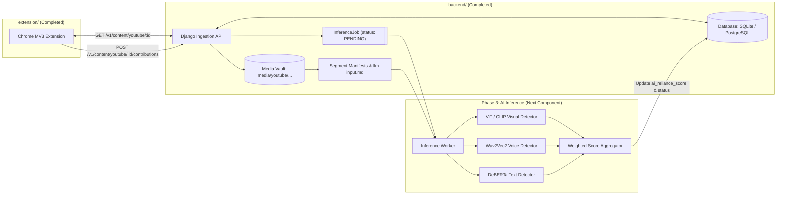

# Project Engineering Master Documentation & Architecture Handoff

> **Project Title**: Crowdsourced Client-Side AI Content Detection System for YouTube  
> **Platform & Target**: Google Chrome Manifest V3 Desktop Extension & Django Multimodal Ingestion Pipeline  
> **Document Purpose**: Authoritative, persistent documentation capturing the complete **What, Why, and How** across all engineering sessions, referencing foundational plans, recording critical architectural decisions, and providing an end-to-end handoff for subsequent project phases.  
> **Master Onboarding Guide**: See [`docs/DEVELOPER_GUIDE_AND_SESSION_LOG.md`](file:///C:/Users/Lakshya/Desktop/AI%20Project/docs/DEVELOPER_GUIDE_AND_SESSION_LOG.md) for full session provenance, technical insights, and step-by-step developer onboarding.

---

## 1. Project Genesis & Foundational Baseline Context

This project originates from the core vision defined in the foundational documents located in `docs/plans/`:

1. **Project Abstract ([`AI lab abstract.pdf`](file:///C:/Users/Lakshya/Desktop/AI%20Project/docs/plans/design%20plans/AI%20lab%20abstract.pdf))**:
   - **Problem**: Centralized scanning of YouTube videos at platform scale is computationally prohibitive and bandwidth-intensive.
   - **Solution**: Organic crowdsourcing. The first viewer of an unmapped or partially mapped video collects lightweight, client-side visual, audio, and transcript evidence strictly while actively watching. This evidence is structured by a server workflow and classified by AI models. Cached scores are stored in a centralized database so all subsequent viewers instantly receive the AI-reliance score without re-analyzing the video.
   - **Team Roles**:
     - *Lakshya Dubey (2024BCS0339)*: Core Domain Model, MV3 Orchestrator & Active-Watch Gate
     - *V Kannabiran (2024BCS0215)*: Screenshot & Tab Audio Capture Adapters + Feasibility Spike
     - *Armaan Z Hussain (2024BCS0323)*: Transcript Extractor, Backend API Adapter & Cache Coordination
     - *Nishanth M (2024BEC0023)*: Policy/Permission Managers, Badge Observers & Filter Strategies

2. **Authoritative Extension Scope ([`extension_scope.md`](file:///C:/Users/Lakshya/Desktop/AI%20Project/docs/plans/design%20plans/extension_scope.md))**:
   - 17 authoritative functional requirements and product boundaries.
   - **Active-Watching Rule**: Zero background collection. Capture strictly while the tab is active, document is visible, video is playing and advancing, and the segment needs coverage.
   - **30-Second Half-Open Segments**: Segment $[k*30, (k+1)*30)$. Sub-interval observation attribution (e.g. Viewer A watching 10s to 48s contributes $[10, 30)$ for Segment 0 and $[30, 48)$ for Segment 1; never claims full-segment coverage upon entry).
   - **Separation of Policy Consent from Browser Permissions**: One-time versioned policy acceptance (`accepted_policy_version = "v1"`) stored locally; no per-video prompts; browser permissions handled separately.
   - **7 Badge States & Opt-In Filtering**: `Analyzed`, `Partially analyzed`, `Not analyzed`, `Collecting evidence`, `Processing`, `Insufficient evidence`, `Unavailable`. Default to `mark_only`.
   - **Privacy Invariant (Requirement 8 & Section 12)**: Zero raw media or transcripts stored in extension storage or local disk; evidence is assembled in volatile memory and uploaded directly to the backend API.

3. **OOP Blueprint ([`extension_input_collection_oop_implementation_plan.pdf`](file:///C:/Users/Lakshya/Desktop/AI%20Project/docs/plans/implementation%20plans/extension_input_collection_oop_implementation_plan.pdf))**:
   - 14-page architectural specification translating the abstract and scope into an Object-Oriented architecture using Composite Specifications (`ActiveWatchGate`), Immutable Value Objects (`TimeInterval`), State Machine (`InputCollectionStateMachine`), and Pluggable Mock/Production Adapters.

---

## 2. Legacy Prototype Audit: Extracted Insights vs. Discarded Flaws

Prior to development, an early prototype in `prototype/` was audited:
* **Discarded Flaws**: Local disk persistence via File System Access API (`window.showDirectoryPicker()`) which violated user privacy; manual button clicks in popup; unimplemented backend upload (`uploadBundle()` threw error); arbitrary chunking without fixed 30s boundaries; lack of badge states.
* **Extracted Insights**: YouTube DOM player selectors (`#movie_player video`, `#movie_player.ad-showing`, `yt-navigate-finish`), virtualized transcript scraping mechanics (`<transcript-segment-view-model>` container scrolling), in-page canvas readability probe, and offscreen audio loopback routing.

---

## 3. Chrome MV3 Extension Implementation (What, Why, and How)

Implemented in `extension/`:
1. **Streamlined In-Page Visual Capture**: In-page canvas 2D frame extraction from `<video>` element (zero user gestures, zero audio muting). Client audio capture was completely removed in favor of the pristine backend server-side audio pipeline (`yt-dlp`), eliminating offscreen documents and intrusive permission prompts.
2. **DOM-First Virtualized Transcript Scraper**: Direct scraping from YouTube's engagement panel with SHA-256 content deduplication, bypassing YouTube's PO token blocks.
3. **Strict Active-Watch Gate**: Evaluates 9 browser conditions in `<50ms` (tab focus, document visibility, clock advance, ad status, missing segment check).
4. **Content-Script Localized Timing**: 250ms monotonic clock advancement in `content.ts` to prevent MV3 service worker sleep drift.
5. **Decoupled OOP Design**: Isolated behind 8 port interfaces (`IPlatformAdapter`, `IBackendApiAdapter`, `IScreenshotCaptureAdapter`, `IAudioCaptureAdapter`, `ITranscriptExtractorAdapter`, `ISegmentationStrategy`, `IPolicyAndPermissionAdapter`, `IBadgeAndFilterExtension`).

---

## 4. Backend Ingestion & Data-Structuring Implementation (What, Why, and How)

Implemented in `backend/`:

### 4.1 Framework Decision: Why Django + DRF?
* **Developer Familiarity**: Aligned directly with the team's high Django experience.
* **Django Admin Superpower**: Provides an instant visual dashboard (`http://localhost:8000/admin/`) to view videos, review segment coverage, inspect frame thumbnails, listen to audio slices, and monitor jobs without writing custom UI.
* **ORM & Migrations**: Rock-solid schema definitions with transactional integrity (`transaction.atomic`) for concurrent interval updates.
* **Storage Flexibility**: Uses `FileSystemStorage` for local development, seamlessly upgradable to S3/GCS (`django-storages`) for cloud deployment.
* **Python AI Synergy**: Resides in the same Python runtime where downstream PyTorch, Transformers, and OpenCV models operate.

### 4.2 Data Structuring Workflow & Services
1. **`interval_merger.py`**:
   - Implements half-open $[start, end)$ interval math with $\epsilon = 0.25$s tolerance.
   - Evaluates segment sufficiency: marks `complete` only when duration coverage $\ge 95\%$ AND modality criteria are satisfied ($\ge 2$ frames OR $\ge 15$s audio).
2. **`media_storage.py`**:
   - Decodes Base64 JPEG frames and Opus WebM audio slices.
   - Saves them to organized, standardized directory hierarchies (`media/youtube/<video_id>/segments/seg_<idx>/contrib_<id>/`).
3. **`transcript_service.py`**:
   - Computes normalized SHA-256 digests of transcript cues.
   - Deduplicates identical full transcripts across multiple contributions, skipping redundant file writes.
4. **`manifest_builder.py`**:
   - Compiles segment `manifest.json` linking frames, audio slices, and speech cues along a unified timestamp timeline.
   - Generates `llm-input.md` as an interleaved chronological text/image timeline ready for multimodal LLM evaluation.
   - Creates `InferenceJob(status='PENDING')` records.

### 4.3 Bidirectional CamelCase Compatibility
The Chrome extension communicates using camelCase DTOs (`videoId`, `observedIntervals`, `missingSegmentIndices`, `aiRelianceScore`). DRF serializers in [`serializers.py`](file:///C:/Users/Lakshya/Desktop/AI%20Project/backend/apps/content/serializers.py) accept and emit camelCase natively with snake_case fallback, ensuring seamless interoperability without breaking changes.

### 4.4 Server-Side Audio Pipeline (`youtube_audio_service.py`)
To eliminate all browser `tabCapture` permission prompts and prevent Chromium `MediaRecorder` async flush corruption, audio extraction runs entirely server-side:
- Uses `yt-dlp` to download the native 160 kbps Opus stream once per video directly to `media/youtube/<video_id>/full_audio.webm`.
- Uses FFmpeg stream copy (`-c copy -avoid_negative_ts make_zero`) to slice the exact observed interval in **~38ms**, generating pristine Matroska/WebM files with exact millisecond duration headers and seek tables.

---

## 5. Repository Layout & Multi-Component Structure

```
C:\Users\Lakshya\Desktop\AI Project/
│
├── docs/                                 # Centralized Architecture & Handoff Vault
│   ├── DEVELOPER_GUIDE_AND_SESSION_LOG.md # Master Developer Onboarding Guide & Session Log
│   ├── README.md                         # Documentation Directory Map & Provenance Index
│   ├── memo/                             # Technical memos & architectural retrospectives
│   └── plans/                            # Foundational & session implementation plans
│
├── extension/                            # Production Chrome Manifest V3 Extension
│   ├── manifest.json                     # Extension manifest
│   ├── package.json                      # Build & test scripts
│   ├── tsconfig.json                     # Strict TypeScript config
│   ├── src/                              # Modular OOP source code (domain, ports, adapters, contexts)
│   ├── tests/                            # 5 Vitest unit suites (40 tests, 100% pass) + Playwright E2E
│   └── dist/                             # Compiled unpacked Chrome extension
│
├── backend/                              # Production Django Ingestion & Structuring Server
│   ├── manage.py                         # Django administrative runner
│   ├── aidetect_backend/                 # Settings, ASGI/WSGI, CORS & root URL routing
│   ├── apps/
│   │   └── content/                      # Content app (models, views, serializers, admin, services)
│   │       ├── services/                 # Interval merger, media storage, transcript, manifest, yt-dlp audio
│   │       └── management/commands/      # Admin initialization command ('init_admin')
│   ├── tests/                            # Comprehensive Django test suite (20 tests, 100% pass)
│   └── media/                            # Structured media vault (media/youtube/<video_id>/...)
│
└── prototype/                            # Legacy Prototype (Retained for reference)
```

---

## 6. Master Verification Matrix

All components have achieved 100% verification across their respective test suites:

| Component | Test Runner | Suites / Tests | Key Invariants Verified | Result |
|---|---|---|---|---|
| **Extension Domain Core** | Vitest | 5 suites / 40 tests | Half-open intervals $[0, 30)$, observation clamping $[10, 30)$, active-watch gate $<50$ms closure, 7 badge states, opt-in filter fail-open invariant, privacy zero-storage invariant. | **Passed (100%)** |
| **Extension Autonomous Browser** | Playwright | Real Chromium | MV3 service worker registration, popup policy acceptance, YouTube DOM badge mounting, active-watch trigger, zero local media leakage. | **Passed (E2E Sign-off)** |
| **Backend Ingestion & Audio** | Django Test Runner | 6 modules / 20 tests | Boundary clamping, disjoint & overlapping merges, 0.25s epsilon tolerance, multi-viewer segment completion, Base64 JPEG decoding, yt-dlp audio slicing & duration validation, SHA-256 transcript deduplication, manifest generation, API camelCase DTO contracts. | **Passed (100%)** |

---

## 7. How the Components Connect & Next Steps (Phase 3 Handoff)



### Actionable Next Steps for Phase 3 (AI Inference Worker):
1. **Implement Inference Worker (`backend/apps/content/management/commands/run_inference_worker.py`)**:
   - Polls `InferenceJob` records where `status='PENDING'`.
   - Reads the target `manifest.json`.
   - Evaluates visual frames using ViT / CLIP ($S_{\text{visual}}$).
   - Evaluates audio chunks using Wav2Vec2 voice classifier ($S_{\text{audio}}$).
   - Evaluates transcript cues using DeBERTa ($S_{\text{text}}$).
   - Computes weighted score: $S_{\text{seg}} = 0.45 \cdot S_{\text{visual}} + 0.35 \cdot S_{\text{audio}} + 0.20 \cdot S_{\text{text}}$.
   - Updates `VideoSegment.ai_segment_score` and time-weighted whole-video `Video.ai_reliance_score`.
   - Marks `InferenceJob.status = 'COMPLETED'`.
