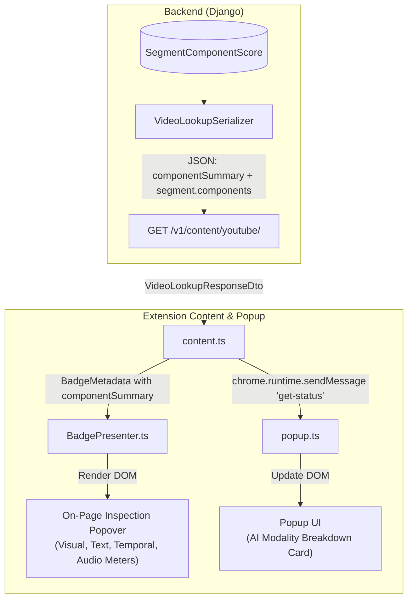

# Plan: Reflecting Multi-Component Scoring Results in the Extension UI

## 1. Executive Summary & Audit Findings

### Current Status
**The Chrome extension is currently NOT displaying component results.**
- **Backend Lookup (`GET /v1/content/youtube/<video_id>`)**: Currently serializes only top-level scalar fields (`aiRelianceScore`, `confidence`, `status`, `label`) and raw segment interval coverage. While `SegmentComponentScore` entries are persisted in the database, `VideoLookupSerializer` does not expose them.
- **On-Page Badge (`BadgePresenter.ts`)**: Currently renders only a single flat line (e.g. `AI Reliance: 82% (AI_GENERATED)` or `Partially Analyzed (2/3 segments)`).
- **Extension Popup (`popup.html` / `popup.ts`)**: Shows video ID, status badge, and segment completion progress bar, but no component breakdown or modality scores.

### Objective
Polish and expose the backend's modular multi-component scoring pipeline—including Visual, Text, Temporal, and Audio modality scores, evaluated component statuses, and peak anomaly diagnostic details—directly in the Chrome extension via:
1. **Interactive On-Page Badge Popover HUD**: Clicking or hovering the `#yt-ai-badge` reveals a native YouTube-styled dark HUD card with modality score meters, peak anomaly flags, and component execution tags.
2. **Extension Popup Breakdown**: An "AI Modality Analysis" card in the extension popup displaying live modality meters and detected component insights for the active video.

---

## 2. Architecture & Data Flow



---

## 3. Implementation Steps

### Phase 1: Backend Serialization Enrichment
**File**: `backend/apps/content/serializers.py`
- Enhance `VideoLookupSerializer`:
  - Add `componentSummary = serializers.SerializerMethodField()`.
  - In `get_componentSummary(self, obj)`:
    - Aggregate all `SegmentComponentScore` records across the video's segments.
    - Calculate modality averages (e.g. `visual`, `text`, `temporal`, `audio`).
    - Collect list of unique `componentsEvaluated` (e.g. `kannabiran_visual_scorer`, `transcript_perplexity_scorer`).
  - In `get_segments(self, obj)`:
    - Include `aiSegmentScore` and `components: [...]` for each segment with `componentName`, `modality`, `score`, `confidence`, `status`, and `details` (e.g. peak anomaly timestamps and explanations).
- Update `backend/apps/content/tests_component_scoring.py` / `tests_api.py` to assert that `GET /v1/content/youtube/<video_id>` returns `componentSummary` and per-segment component scores.

### Phase 2: Extension DTO and Port Model Updates
**File**: `extension/src/ports/IBackendApiAdapter.ts`
- Define `ComponentScoreDto`:
  ```typescript
  export interface ComponentScoreDto {
    readonly componentName: string;
    readonly modality: 'visual' | 'text' | 'temporal' | 'audio' | string;
    readonly score: number | null;
    readonly confidence?: number | null;
    readonly status: 'SUCCESS' | 'SKIPPED' | 'FAILED';
    readonly executionTimeMs?: number;
    readonly details?: Record<string, any>;
    readonly errorMessage?: string;
  }
  ```
- Define `ComponentSummaryDto`:
  ```typescript
  export interface ComponentSummaryDto {
    readonly modalityAverages: Record<string, number>;
    readonly componentsEvaluated: ReadonlyArray<string>;
    readonly totalEvaluations: number;
  }
  ```
- Update `VideoLookupResponseDto` with optional `componentSummary?: ComponentSummaryDto` and per-segment `components?: ReadonlyArray<ComponentScoreDto>`.
- Update `BadgeMetadata` in `extension/src/ports/IBadgeAndFilterExtension.ts` to accept `componentSummary?: ComponentSummaryDto` and `segments`.

### Phase 3: On-Page Badge UI & Popover HUD Polish
**Files**: `extension/src/extensions/badges/BadgePresenter.ts`, `extension/src/extensions/badges/badge.css`
- **Badge Pill**: Keep the clean, unobtrusive badge pill next to the video title or player controls, but add an expand toggle / hover chevron (▾).
- **Inspection Popover (`.yt-ai-popover`)**:
  - Appears smoothly on hover or click.
  - **Overall Score Header**: Circular/pill gauge showing aggregate AI Reliance % and classification label (`AI_GENERATED`, `MIXED`, `HUMAN_MADE`).
  - **4-Modality Meter Grid**:
    - 👁️ **Visual Modality**: e.g. `82%` (with color-coded progress bar: green < 40%, yellow 40-70%, red > 70%).
    - 📝 **Text / Script**: e.g. `88%` (synthesized script likelihood).
    - ⏱️ **Temporal Continuity**: e.g. `45%` (frame-to-frame flow anomalies).
    - 🎙️ **Audio Synthesis**: e.g. `50%` (voice clone/spectral artifacts).
  - **Diagnostic Anomalies Box**:
    - Displays peak anomaly timestamps (e.g., `⚠️ Peak Anomaly at 00:15 - Isolated synthetic cutaway detected`).
  - **Active Components Footer**:
    - Small chips displaying which scoring models ran (e.g., `Kannabiran Visual (ViT)`, `Transcript Perplexity`).
- **YouTube Native Dark Styling**:
  - Matches YouTube's native design tokens (`#0f0f0f` / `#212121`, rounded corners `12px`, subtle border `#3f3f3f`, `z-index: 9999`).
  - Dismisses on click-outside or mouse-leave.

### Phase 4: Extension Popup UI AI Breakdown
**Files**: `extension/src/contexts/popup.html`, `extension/src/contexts/popup.css`, `extension/src/contexts/popup.ts`, `extension/src/contexts/content.ts`
- **Content Script Messaging**:
  - In `content.ts`, update the `get-status` listener to include `currentLookup` (or `componentSummary` and `aiRelianceScore`) in the response message.
- **Popup HTML**:
  - Add an `<section class="card" id="modality-breakdown-card">`:
    - Modality score rows: Visual, Text, Temporal, Audio with percentage labels and animated mini-bars.
    - Diagnostics snippet: peak anomaly timestamp or "No synthetic anomalies flagged".
- **Popup Script**:
  - In `refreshStatus()`, populate modality bars when a video with component analysis is active. If no analysis exists yet, show a clean "Awaiting component analysis" placeholder.

---

## 4. Verification & Testing Plan

1. **Backend Tests**:
   - Run `python manage.py test apps.content` to verify:
     - All existing 42 tests continue to pass.
     - New test verifying `VideoLookupView` returns populated `componentSummary` and segment `components`.
2. **Extension Unit Tests**:
   - Run Vitest suite (`npm test` in `extension/`):
     - Add unit tests for `BadgePresenter` rendering the popover card, modality meters, and anomaly tags with complete and partial `BadgeMetadata`.
3. **Extension Build**:
   - Run `node scripts/build.mjs` (or `npm run build`) in `extension/` to ensure bundle compiles cleanly with zero TypeScript or bundling errors.
4. **Visual & Behavioral Verification**:
   - Verify layout and styling responsiveness against YouTube player dimensions.
