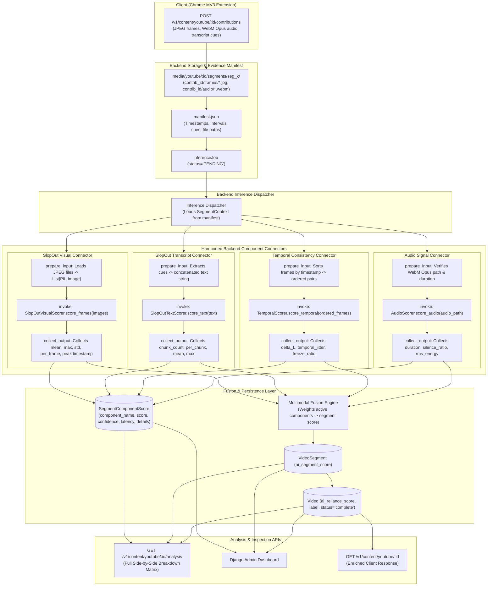

# Modular Multi-Component AI Scoring Architecture with Hardcoded Backend Connectors

## Goal Description

The objective of this architecture is to establish a **modular, fault-isolated multi-component inference framework** where:
1. **Multiple independent components** evaluate different parts of the multimodal evidence captured by the Chrome extension (visual frames, transcript text, audio streams, temporal frame sequences).
2. For every component, the backend contains **dedicated, hardcoded connector code** that:
   - **Prepares the exact input structure** the component expects from the raw extension files and manifest (e.g., converting frame file paths to PIL Images, extracting concatenated English transcript text, or preparing ordered timestamp-frame pairs).
   - **Invokes the component** within a fault-isolated runtime wrapper.
   - **Collects the variety of details, metrics, and diagnostic signals** returned by that component (not just a single float score), normalizing them into persistent records.
3. **Runtime Fault Isolation**: A failure, unhandled exception, corrupt asset, or CUDA OOM in any one component is isolated within that component's connector. It records `status="FAILED"` with error diagnostics and allows all other components to proceed normally without crashing the backend or interrupting API requests.
4. **Integration of Team Component (`kannabiran_AI_Project` / SlopOut)**: Ingests the team's visual frame detector (CLIP ViT-B/32 + ViT baseline) and transcript NLP detector (RoBERTa on HC3), preserving their empirical findings regarding compression artifacts and chunking.
5. **Future-Proofing for Audio and Temporal Signals**: Establishes first-class hardcoded connectors for temporal frame dynamics (inter-frame luminance deltas and jitter) and audio signal analysis (WebM Opus chunk properties / synthetic voice stubs).
6. **Backend Schema & Comparative Analysis**: Persists the variety of component details into `SegmentComponentScore`, supporting side-by-side strategy comparison in Django Admin and via a dedicated analysis API (`GET /v1/content/youtube/<video_id>/analysis`).

---

## Architectural Blueprint

---

## Technical Details & Component Contracts

### Hardcoded Backend Connectors for Component-Specific Input/Output
Rather than forcing components into an artificial, one-size-fits-all signature, each component has a dedicated **hardcoded connector** in the backend:
- **Input Preparation**: The connector inspects the segment context and constructs the precise input types and shapes the component requires (e.g. `List[PIL.Image]` for vision, raw `str` for transcript NLP, ordered `(timestamp, Path)` pairs for temporal analysis, or `Path` to WebM file for audio).
- **Output Collection**: The connector knows the exact schema returned by the component and collects its specific variety of metrics into `SegmentComponentScore.details`.
- **Fault Isolation**: Each connector runs in an isolated `try...except` block, ensuring a component failure or missing file never crashes the backend.

### Shared Python Virtual Environment & Lazy Loading
All components share the backend's Python environment. Heavy ML libraries (e.g., PyTorch, Transformers) are loaded lazily inside their respective component modules so that lightweight connectors (e.g., temporal motion calculation or audio metadata checks) remain instant and consume negligible memory.
