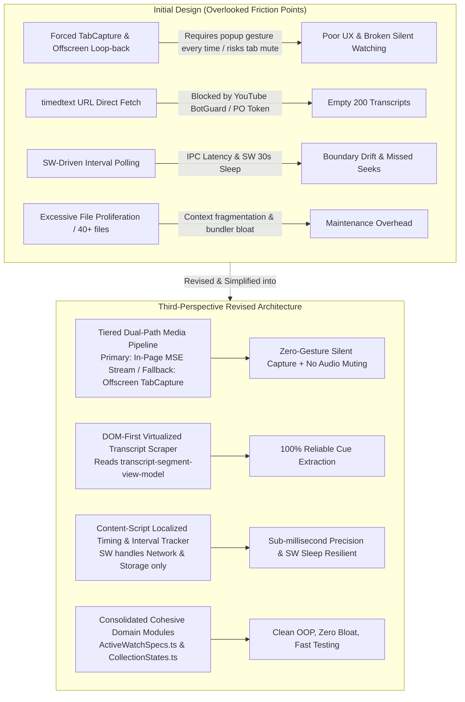
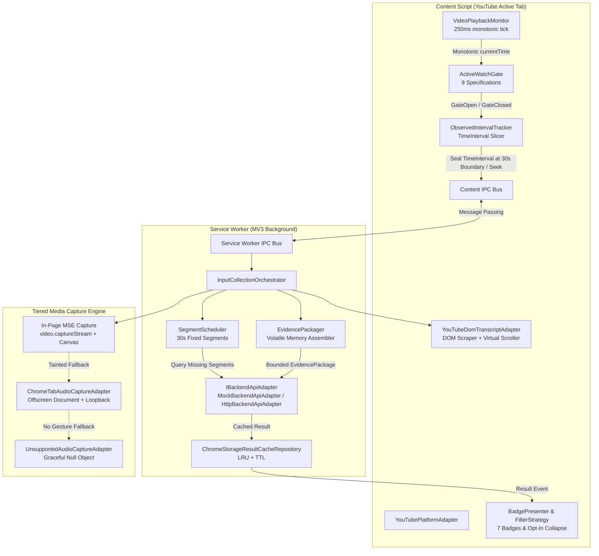
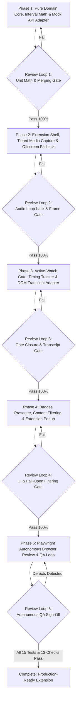

# YouTube AI-Content Detection Extension — Revised OOP Implementation Plan

## Goal Description

This project delivers a robust, production-grade Chrome Manifest V3 (MV3) extension for crowdsourced, client-side AI content detection on YouTube desktop. As specified in [extension_input_collection_oop_implementation_plan.pdf](file:///C:/Users/Lakshya/Desktop/AI%20Project/docs/plans/implementation%20plans/extension_input_collection_oop_implementation_plan.pdf) and [extension_scope.md](file:///C:/Users/Lakshya/Desktop/AI%20Project/docs/plans/design%20plans/extension_scope.md), the extension crowdsources lightweight evidence collection organically:
1. The first active viewer of an unmapped or partially mapped video contributes bounded evidence (visual samples and segment-scoped audio) strictly for the timestamp intervals they actually watch.
2. The backend Structuring Workflow and AI Inference service computes AI-reliance scores and updates segment coverage.
3. Subsequent viewers instantly retrieve cached scores and segment coverage from the backend, skipping redundant capture and viewing informative badges and opt-in threshold filtering.

---

## Third-Perspective Critical Audit: Overlooked Issues, Root Causes & Proposed Revisions

Evaluating the initial design and the legacy `prototype/` from an independent, third-perspective systems engineering viewpoint reveals five critical real-world friction points. The initial plan steered heavily toward formal patterns without accounting for YouTube-specific quirks, MV3 lifecycle realities, and Chrome API quotas.



### 1. Overlooked Cause: Audio Muting Risk & UX Friction of Forced `chrome.tabCapture`
* **Root Cause**: The initial plan assumed tab audio capture would always go through Chrome's `tabCapture` API via an MV3 offscreen document. However, `chrome.tabCapture.getMediaStreamId` requires an explicit, synchronous user gesture (e.g. clicking a popup button) and places a prominent capture badge on the tab. If the audio routing back to `audioContext.destination` hiccups, the user's video is instantly muted.
* **Prototype Insight**: The prototype revealed that YouTube streams media via Media Source Extensions (MSE) onto the `<video>` element under a same-origin `blob:https://www.youtube.com/...` URL. Calling `video.captureStream()` directly in the content script extracts the video's audio tracks without muting playback, without requiring a popup click, and without recording unrelated browser or tab sounds!
* **Proposed Revision**: Implement a **Tiered Dual-Path Media Adapter**:
  * **Primary (In-Page MSE Stream)**: Use `video.captureStream()` directly in the content script. It runs automatically during active watching, never mutes the speaker output, captures only the video's audio, and requires zero user gestures.
  * **Secondary (Offscreen TabCapture Fallback)**: If canvas/audio is cross-origin tainted, fall back to `ChromeTabAudioCaptureAdapter` when authorized via the popup "Enable Contribution" gesture.
  * **Graceful Degradation**: If neither is accessible, bind `UnsupportedAudioCaptureAdapter` (`capabilities.tabAudio = false`), allowing visual screenshot and transcript contributions to proceed smoothly without disrupting playback.

### 2. Overlooked Cause: YouTube `timedtext` Blocked by Proof-of-Origin (PO) Tokens
* **Root Cause**: The initial plan proposed fetching captions via the URLs listed in `playerCaptionsTracklistRenderer.captionTracks[].baseUrl`. In production YouTube, requests to `timedtext` without a fresh Proof-of-Origin (PO) token / WebGPU session attestation generated by the player return HTTP 200 with an empty body.
* **Prototype Insight**: YouTube's open transcript panel renders real DOM elements (`<transcript-segment-view-model>`) with `.ytwTranscriptSegmentViewModelTimestamp` and `<span role="text">`. Because YouTube virtualizes this list, scrolling the container by `clientHeight * 0.85` dynamically loads and renders all cues.
* **Proposed Revision**: Standardize on **DOM-First Virtualized Transcript Extraction**:
  * Primary: Scrape `<transcript-segment-view-model>` directly from YouTube's engagement panel, clicking "Show transcript" if closed, and scrolling the virtualized container to build the complete cue list.
  * Secondary: Fall back to player API memory inspection (`player.getPlayerResponse()`).
  * Tertiary: Label scope accurately (`full` | `partial` | `unavailable`) with SHA-256 hash deduplication.

### 3. Overlooked Cause: Service Worker Sleep & Extension IPC Latency on Playback Drift
* **Root Cause**: MV3 Service Workers are ephemeral and terminate after 30 seconds of inactivity. If the Service Worker attempts to poll or govern 250ms playback ticks over `chrome.tabs.sendMessage`, IPC latency (5–50ms) introduces boundary drift and race conditions during rapid seeks or segment boundary rollovers (`29.9s -> 30.1s`).
* **Proposed Revision**: **Content-Script Localized Timing & Volatile Interval Sealing**:
  * Host `ObservedIntervalTracker`, `ActiveWatchGate`, and `VideoPlaybackMonitor` directly in the Content Script. It evaluates monotonic time advancement, user seeks, and segment rollovers synchronously at sub-millisecond precision.
  * The Service Worker acts strictly as a **Stateless Gateway**: handling deduplicated backend lookups, payload compression, atomic HTTP uploads, exponential retry backoff, and local cache storage.

### 4. Overlooked Cause: Excessive Class Proliferation & Architectural Over-Engineering
* **Root Cause**: Decomposing 9 simple boolean conditions into 9 separate class files and 6 state transitions into 6 separate files creates 30+ micro-files. This causes bundler bloat, circular import risks, and fragmented test suites without adding functional value.
* **Proposed Revision**: **Consolidated Cohesive Modules**:
  * Preserve 100% of the OOP abstractions and interfaces (`ActiveWatchGate`, `IGateSpecification`, `InputCollectionStateMachine`), but consolidate specifications into `src/domain/specifications/ActiveWatchSpecs.ts` and state definitions into `src/domain/state/CollectionStates.ts`.
  * Keeps the domain layer pure, clean, fast to test (<1 second execution), and easy to navigate.

### 5. Overlooked Cause: Need for Real Browser-Level Autonomous Review
* **Root Cause**: Unit tests with mocked clocks can verify interval math, but cannot verify whether YouTube DOM selectors break, whether the video element is visible on screen, or whether badges distort YouTube's layout.
* **Proposed Revision**: Include a dedicated **Autonomous Playwright Browser Review Agent** that launches Chromium with the built extension loaded, navigates live test pages, verifies DOM badge injection and popup controls, validates active-watch gate shutdown on tab switch/pause, and autonomously reports bugs back into the development review loop.

---

## Revised Architecture



---

## User Review Required

> [!IMPORTANT]
> **1. Workspace Layout**:
> The production extension will be created cleanly in `src/` at the workspace root, compiling via Vite/TypeScript into `dist/` (which can be loaded directly as an unpacked extension in Chrome). The existing `prototype/` folder remains untouched for historical reference.
>
> **2. Tiered Media Capture Mode**:
> Visual frames and audio are captured in-page via `<video>` MSE streams and canvas sampling as the primary path (zero popup prompts required, no tab muting). Offscreen tabCapture is retained strictly as an opt-in fallback for tainted content.
>
> **3. Mock Adapter by Default**:
> The extension is configured with `MockBackendApiAdapter` out of the box, supporting stateful in-memory segment merging for two simulated viewers (`Viewer A [10, 48)` and `Viewer B [0, 10)` & `[48, 60)`). Switching to production HTTP is a one-line config flag.

---

## Open Questions

> [!NOTE]
> 1. **Testing Environment**: Playwright with Chromium (version 153.0.8010.12) is verified working. Are you comfortable with our autonomous browser review agent running tests against both local mock YouTube HTML fixtures and real YouTube watch pages?
> 2. **Default Segment Duration**: The specification defaults to 30 seconds (`[0, 30)`, `[30, 60)`). We will expose this as a configurable parameter in `ConfigurableFixedSegmentationStrategy`.

---

## Phased Multi-Agent Implementation Roadmap & Review Loops

The work is organized into **five sequential, non-parallel phases**. Each phase ends with a mandatory **Review Loop Gate** that must achieve 100% verification before the next phase begins.



### Team Roles & Agent Mapping
| Role Name | Subagent Type | Key Ownership |
|---|---|---|
| **Lead Architect** | `main` | Build tooling, phase gating, container wiring, final QA sign-off |
| **Core Domain Architect** | `core-domain-agent` | `TimeInterval`, `VideoSegment`, `EvidencePackage`, `ActiveWatchSpecs`, `CollectionStates` |
| **Media & Audio Specialist** | `media-capture-agent` | Tiered screenshot & audio adapters, offscreen loopback, canvas probe |
| **API & Transcript Specialist** | `api-transcript-agent` | `MockBackendApiAdapter`, `HttpBackendApiAdapter`, `YouTubeDomTranscriptAdapter`, SHA-256 |
| **UI & Filter Specialist** | `ui-filter-agent` | `PolicyConsentManager`, `BadgePresenter` (7 states), `IFilterStrategy`, Popup UI |
| **Autonomous Browser Reviewer** | `browser-reviewer-agent` | Playwright browser runner, live extension loading, defect logging, review loop |

---

### Phase 1: Pure Domain Core, Interval Math & Mock API Adapter
* **Assigned Agent**: `core-domain-agent` supervised by `main`.
* **Deliverables**:
  * Build setup: `package.json`, `tsconfig.json`, `vite.config.ts`, Vitest harness.
  * Abstract port interfaces in `src/ports/`: `IPlatformAdapter`, `IBackendApiAdapter`, `IScreenshotCaptureAdapter`, `IAudioCaptureAdapter`, `ITranscriptExtractorAdapter`, `ISegmentationStrategy`, `IPolicyAndPermissionAdapter`, and `IBadgeAndFilterExtension`.
  * Immutable Domain Value Objects in `src/domain/models/`:
    * `TimeInterval`: Half-open `[startSeconds, endSeconds)` math, bounds validation, duration, intersection, and contiguous merging with 0.25s epsilon.
    * `VideoSegment`: Segment bounds, `CoverageStatus` (`missing` | `partial` | `complete`), observation clamping.
    * `EvidencePackage`: Volatile container for frames, audio chunks, transcripts, and capability flags.
  * `MockBackendApiAdapter` in `src/adapters/mocks/`: In-memory multi-viewer interval merging store (Viewer A `[10, 48)` + Viewer B `[0, 10)` & `[48, 60)` -> Segments 0 & 1 complete).
* **Review Loop 1 (Unit Math & Merging Gate)**:
  * Tests #4, #5, #6, #7: Verify half-open boundary math, partial observation clamping, and atomic multi-viewer interval merging.
  * **Gate**: 100% unit tests pass before starting Phase 2.

---

### Phase 2: Extension Shell, Tiered Media Capture & Offscreen Fallback
* **Assigned Agent**: `media-capture-agent`.
* **Deliverables**:
  * MV3 `manifest.json`: Requesting only `storage`, `activeTab`, `offscreen`, and YouTube host permissions.
  * Tiered Media Adapters:
    * `InPageMediaCaptureAdapter`: Direct `video.captureStream()` audio and canvas frame grabbing without muting or user gesture.
    * `ChromeTabAudioCaptureAdapter`: Offscreen document audio recorder routing to `audioContext.destination` so user playback remains audible.
    * `UnsupportedAudioCaptureAdapter`: Graceful null-adapter fallback.
    * `ChromeVisibleTabScreenshotAdapter`: Downscales visible tab screenshots to max 1280px at 0.75 JPEG quality with 150 KB ceiling.
    * `MockScreenshotCaptureAdapter` & `MockAudioCaptureAdapter` for headless tests.
  * Offscreen document: `src/contexts/offscreen.html` and `src/contexts/offscreen.ts`.
* **Review Loop 2 (Audio Loop-Back & Frame Gate)**:
  * Verify in test harness that audio playback remains unmuted, audio chunks align within <100ms drift, and graceful fallback triggers when gesture is missing.
  * **Gate**: Zero audio muting and verified graceful fallback before starting Phase 3.

---

### Phase 3: Active-Watch Gate, Timing Tracker & DOM Transcript Adapter
* **Assigned Agent**: `core-domain-agent` & `api-transcript-agent`.
* **Deliverables**:
  * `YouTubePlatformAdapter`: Parses `/watch?v=`, `/shorts/`, and `youtu.be/` URLs; observes `yt-navigate-finish` for SPA navigation.
  * `ActiveWatchGate` and `ActiveWatchSpecs.ts`: 9 consolidated gate specifications evaluating tab focus, document visibility, video playing, monotonic currentTime delta, seeking, and missing segments.
  * `ObservedIntervalTracker`: Runs 250ms tick in content script, detects user scrubs/seeks, seals `TimeInterval` at 30s segment boundaries, and flushes bounded evidence.
  * `YouTubeDomTranscriptAdapter`: DOM-first scraping of `<transcript-segment-view-model>` with virtualized scrolling and Web Crypto SHA-256 content deduplication.
  * `ChromeStorageResultCacheRepository`: Bounded LRU cache in `chrome.storage.local` with TTL.
* **Review Loop 3 (Gate Closure & Transcript Gate)**:
  * Tests #1, #2, #3, #8, #9, #10, #11, #12, #14, #15:
    * URL parsing across all YouTube link formats.
    * Gate closes within <50ms on pause, tab switch, or window blur.
    * Transcript scope accurately reports `full`, `partial`, or `unavailable`.
    * Privacy invariant spy verifies zero raw media strings in `chrome.storage.local`.
  * **Gate**: Immediate gate shutdown and clean transcript deduplication verified.

---

### Phase 4: Badges Presenter, Content Filtering & Extension Popup
* **Assigned Agent**: `ui-filter-agent`.
* **Deliverables**:
  * `BadgePresenter`: Maps state machine lifecycle to 7 on-page UI badges (`Analyzed`, `Partially analyzed`, `Not analyzed`, `Collecting evidence`, `Processing`, `Insufficient evidence`, `Unavailable`).
  * `IFilterStrategy`:
    * `MarkOnlyFilterStrategy` (default): Badges only, zero content hidden.
    * `ThresholdHideFilterStrategy` (opt-in): Reversible CSS collapse only on completed high-reliance AI scores, exposing one-click session reveal. Fail-open invariant enforced.
  * `PolicyConsentManager`: Versioned consent (`v1`) stored in `chrome.storage.local`.
  * Extension Popup UI (`src/contexts/popup.html`, `popup.ts`): Versioned policy onboarding, "Enable Contribution" user gesture trigger, live segment coverage bar, and filter settings.
* **Review Loop 4 (UI & Fail-Open Filtering Gate)**:
  * Test #13: Verify all 7 badge states render cleanly.
  * Verify filtering defaults to `mark_only` and never hides partial or unknown videos.
  * **Gate**: Verified fail-open behavior and clean UI mounting before starting Phase 5.

---

### Phase 5: Playwright Autonomous Browser Review & QA Loop
* **Assigned Agent**: `browser-reviewer-agent` collaborating with developer agents.
* **Deliverables**:
  * Build complete extension bundle into `dist/`.
  * End-to-end Playwright browser test suite launching Chromium with `--load-extension=dist/`:
    1. Loads extension popup, tests one-time policy acceptance, verifies `chrome.storage.local` persistence.
    2. Navigates to YouTube watch fixtures; verifies active-watch gate triggers only during visible, unpaused playback.
    3. Simulates pause, seek, and tab switch; verifies capture halts immediately without boundary over-claiming.
    4. Validates on-page badge rendering and CSS threshold filtering with session reveal.
    5. Audits `chrome.storage.local` to assert zero media or transcript bytes are retained.
* **Review Loop 5 (Autonomous QA Sign-Off)**:
  * The Reviewer agent logs any defects found (timing drifts, selector mismatches, layout styling).
  * Developer agents apply immediate fixes.
  * Re-build and re-test until all 15 automated test criteria and 13 manual acceptance checks pass.
  * Produce final `README.md` and walkthrough summary.

---

## Proposed Changes (File Structure)

```
src/
├── domain/
│   ├── models/
│   │   ├── TimeInterval.ts           # [NEW] Immutable half-open interval math & merging
│   │   ├── VideoSegment.ts           # [NEW] Segment model with bounds and coverage status
│   │   ├── EvidencePackage.ts        # [NEW] Volatile evidence container
│   │   └── PolicyState.ts            # [NEW] Policy consent & preferences model
│   ├── specifications/
│   │   ├── IGateSpecification.ts     # [NEW] Gate specification interface & snapshot
│   │   ├── ActiveWatchSpecs.ts       # [NEW] 9 consolidated concrete gate specifications
│   │   └── ActiveWatchGate.ts        # [NEW] Composite gate with event notification
│   ├── state/
│   │   ├── ICollectionState.ts       # [NEW] State interface
│   │   ├── CollectionStates.ts       # [NEW] 6 concrete lifecycle states
│   │   └── InputCollectionStateMachine.ts # [NEW] State machine coordinator
│   └── services/
│       ├── SegmentScheduler.ts       # [NEW] Deterministic 30s scheduler
│       ├── ObservedIntervalTracker.ts # [NEW] In-tab 250ms monotonic clock & interval sealer
│       └── EvidencePackager.ts       # [NEW] Volatile package assembler
├── ports/
│   ├── IPlatformAdapter.ts           # [NEW] Platform abstraction (YouTube / extensible)
│   ├── IBackendApiAdapter.ts         # [NEW] Backend lookup & contribution contract
│   ├── IScreenshotCaptureAdapter.ts  # [NEW] Frame capture abstraction
│   ├── IAudioCaptureAdapter.ts       # [NEW] Segment-scoped audio abstraction
│   ├── ITranscriptExtractorAdapter.ts # [NEW] Accessible transcript extraction
│   ├── ISegmentationStrategy.ts      # [NEW] Configurable segmentation strategy
│   ├── IPolicyAndPermissionAdapter.ts # [NEW] Policy consent & browser permission port
│   └── IBadgeAndFilterExtension.ts   # [NEW] Badge observer & filter strategy ports
├── adapters/
│   ├── mocks/
│   │   ├── MockBackendApiAdapter.ts  # [NEW] In-memory multi-viewer interval merging store
│   │   ├── MockScreenshotCaptureAdapter.ts # [NEW] Synthetic timestamped JPEG generator
│   │   ├── MockAudioCaptureAdapter.ts # [NEW] Synthetic audio chunk generator
│   │   └── MockTranscriptExtractorAdapter.ts # [NEW] Full/partial/unavailable fixtures
│   ├── youtube/
│   │   ├── YouTubePlatformAdapter.ts # [NEW] YouTube DOM selectors & SPA navigation
│   │   └── YouTubeDomTranscriptAdapter.ts # [NEW] DOM-first virtualized transcript scraper
│   ├── media/
│   │   ├── InPageMediaCaptureAdapter.ts # [NEW] Primary: video.captureStream + Canvas
│   │   ├── ChromeTabAudioCaptureAdapter.ts # [NEW] Fallback: tabCapture + Offscreen loopback
│   │   ├── ChromeVisibleTabScreenshotAdapter.ts # [NEW] captureVisibleTab + OffscreenCanvas
│   │   └── UnsupportedAudioCaptureAdapter.ts # [NEW] Graceful null-adapter
│   ├── storage/
│   │   ├── ChromeStorageResultCacheRepository.ts # [NEW] LRU cache in chrome.storage.local
│   │   └── StoragePolicyConsentAdapter.ts # [NEW] Versioned policy storage adapter
│   └── http/
│       └── HttpBackendApiAdapter.ts  # [NEW] Production HTTP adapter with Retry-After backoff
├── extensions/
│   ├── badges/
│   │   ├── BadgePresenter.ts         # [NEW] Observer mapping states to 7 UI badges
│   │   └── badge.css                 # [NEW] Non-intrusive badge styles
│   └── filtering/
│       ├── MarkOnlyFilterStrategy.ts # [NEW] Default badge-only mode
│       └── ThresholdHideFilterStrategy.ts # [NEW] Opt-in threshold overlay with session reveal
├── contexts/
│   ├── content.ts                    # [NEW] Content script entrypoint
│   ├── background.ts                 # [NEW] MV3 service worker entrypoint
│   ├── offscreen.html                # [NEW] Offscreen audio document HTML
│   ├── offscreen.ts                  # [NEW] Offscreen audio loopback handler
│   ├── popup.html                    # [NEW] Extension popup UI
│   ├── popup.css                     # [NEW] Popup styling
│   └── popup.ts                      # [NEW] Popup controller
├── tests/
│   ├── unit/                         # [NEW] Vitest suites for interval math & specifications
│   │   ├── TimeInterval.test.ts
│   │   ├── ActiveWatchGate.test.ts
│   │   ├── ObservedIntervalTracker.test.ts
│   │   ├── SegmentScheduler.test.ts
│   │   └── MockBackendApiAdapter.test.ts
│   └── e2e/                          # [NEW] Playwright automated browser test suite
│       ├── extension-loader.spec.ts
│       ├── active-watch-gate.spec.ts
│       ├── badge-rendering.spec.ts
│       └── storage-invariant.spec.ts
├── manifest.json                     # [NEW] Clean MV3 extension manifest
├── vite.config.ts                    # [NEW] Extension bundler configuration
└── tsconfig.json                     # [NEW] Strict TypeScript configuration
```

---

## Verification Plan

### Automated Tests (`npm test` / Vitest)
* **Test #1**: YouTube URL parsing (`/watch?v=`, `/shorts/`, `youtu.be/`).
* **Test #2**: Gate fails when tab/document is hidden, video is paused, or playback stalls.
* **Test #3**: <50ms immediate stop and partial interval flush on navigation or pause.
* **Test #4**: Half-open boundary arithmetic `[0, 30)`, `[30, 60)` and partial final segment.
* **Test #5**: Bounded contribution records only observed intervals `[10, 30)` & `[30, 48)`.
* **Test #6**: Partial contribution leaves remaining intervals uncovered.
* **Test #7**: Multi-viewer intervals merge atomically in `MockBackendApiAdapter`.
* **Test #8**: Complete cached results skip evidence collection entirely.
* **Test #9**: Strict distinction between full, partial, and unavailable transcript scopes.
* **Test #10**: One-time policy acceptance per version (`v1`).
* **Test #11**: Zero evidence captured when policy mismatches or contribution is disabled.
* **Test #12**: Zero evidence captured when active-watch gate fails.
* **Test #13**: All 7 badge states render correctly; filtering defaults to `mark_only` and never hides partial/unknown videos.
* **Test #14**: API failure and rate limiting (429 Retry-After) handled safely without crashing.
* **Test #15**: Privacy invariant spy confirms zero raw media or transcript text in `chrome.storage.local`.

### Autonomous Playwright Browser Review (`npm run test:e2e`)
* Launches Chromium with `--load-extension=dist/` and runs end-to-end tests:
  1. Opens popup, accepts policy v1, verifies persistence in `chrome.storage.local`.
  2. Opens watch page fixture, verifies active-watch gate triggers only when playing and visible.
  3. Tests seek/scrub behavior: asserts skipped intervals are not recorded.
  4. Inspects DOM badges injected near video player and on cards.
  5. Toggles threshold filter and tests click-to-reveal.
  6. Inspects extension console and storage for zero raw media leakage.

### Manual Acceptance Checklist
- [ ] Accept policy in popup; navigate across videos without repeat prompts.
- [ ] Bump policy version (`v1` -> `v2`); verify capture halts until accepted.
- [ ] Open video in background tab; verify zero capture.
- [ ] Switch tabs while playing; verify capture stops within <50ms.
- [ ] Pause video; verify capture halts immediately.
- [ ] Verify audio playback remains completely audible to the user during capture.
- [ ] Verify cached completed videos show score badge and skip capture.
- [ ] Verify no raw media or transcript strings in `chrome.storage.local`.
