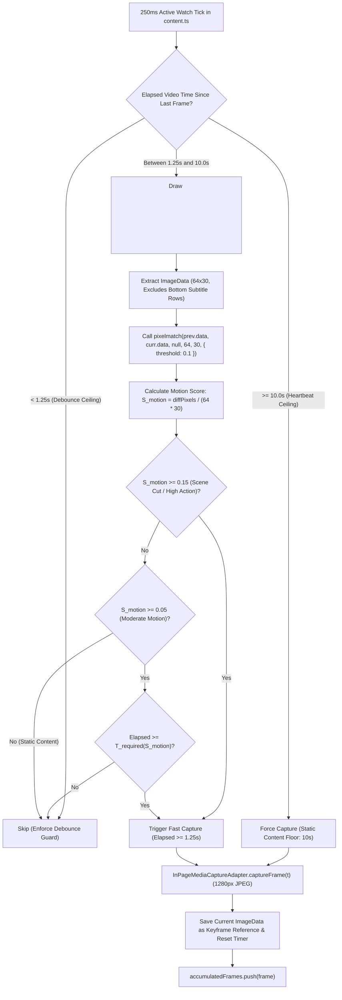

# Implementation Plan: Motion-Adaptive Frame Sampling using Mapbox `pixelmatch`

> **Target Platform**: Google Chrome Manifest V3 Desktop Extension (`extension/`)  
> **Target Subsystems**: Media Capture & Content Orchestration (`extension/package.json`, `extension/src/ports/`, `extension/src/adapters/media/`, `extension/src/contexts/content.ts`)  
> **Core Engine**: [`mapbox/pixelmatch`](https://github.com/mapbox/pixelmatch) (Industry-standard open-source pixel comparator)  
> **Author**: Antigravity AI Engineering Assistant  
> **Status**: PENDING USER APPROVAL  

---

## 1. Goal Description

Currently, the Chrome extension captures visual evidence at a **fixed static interval of 5.0 seconds** of video playback time (`Math.abs(t - lastFrameCaptureTime) >= 5.0`).
Across a 30-second segment, this captures exactly 6 full-resolution JPEG frames (~1280px, ~150 KB each, totaling ~1 MB per segment):
- **Static Content (Slide decks, lectures, still podcast covers, audiobooks)**: 5 of the 6 frames are visually identical. Uploading redundant visual stills wastes client upload bandwidth, backend media storage vault space, and expensive downstream multimodal AI vision tokens (Gemini / Claude / ViT charges per image token).
- **Rapid / High-Motion Content (Action scenes, gaming montages, rapid-cut editing, deepfake morphing)**: A fixed 5-second interval skips critical scene transitions, cuts, and visual artifacts where generative AI inconsistencies are most detectable.

### The Objective
Implement an intelligent **Motion-Adaptive Frame Sampling Strategy** powered by Mapbox's open-source **`pixelmatch`** library:
1. **Samples static content slowly**: Decelerates down to a safe heartbeat ceiling ($t_{\text{max}} = 10.0\text{s}$), producing 2–3 frames per 30-second segment (~50%–67% payload reduction) while unconditionally satisfying the backend sufficiency requirement ($\text{frame\_count} \ge 2$).
2. **Samples rapid content faster**: Accelerates up to a debounce ceiling ($t_{\text{min}} = 1.25\text{s}$), capturing rapid scene cuts, camera panning, and high-motion events with fine temporal precision (up to 8–10 frames per segment).
3. **Preserves extension integrity**: Strictly isolates the sampling decision behind a clean OOP interface (`IFrameSamplingStrategy`), ensuring zero breaking changes to `ActiveWatchGate`, `ObservedIntervalTracker`, `EvidencePackage`, `SegmentScheduler`, Service Worker, badges, or backend APIs.

---

## 2. User Review Required

> [!IMPORTANT]
> **Mapbox `pixelmatch` Dependency Addition**:
> We will add `pixelmatch` (`^6.0.0` or `^5.3.0`) and `@types/pixelmatch` to `extension/package.json`. Because `extension/scripts/build.mjs` configures esbuild with `bundle: true`, `pixelmatch` will be automatically bundled into `dist/src/contexts/content.js` with zero runtime manifest configuration required and a tiny footprint (~3 KB).

> [!NOTE]
> **Backend Sufficiency & Subtitle Immunity**:
> - **Backend Sufficiency**: Setting the maximum heartbeat interval to $10.0\text{s}$ guarantees that even in 100% static videos, at least 3 frames ($t = 0\text{s}, 10\text{s}, 20\text{s}$) are collected across each 30-second segment, unconditionally satisfying the backend sufficiency rule ($\text{frame\_count} \ge 2$).
> - **Subtitle Immunity**: YouTube auto-generated captions or rolling news tickers appear in the bottom 12–15% of the video. The sampler measures only the top 85% rows on the downsampled canvas (e.g. 30 of 36 rows), preventing caption popups from falsely triggering high-frequency sampling on static lectures or slides.

---

## 3. Algorithmic Workflow & Cadence Architecture



### Dynamic Cadence Specifications:
1. **Debounce Ceiling ($t_{\text{min}} = 1.25\text{s}$)**:
   Never capture faster than every $1.25\text{s}$, even during explosions or rapid cuts (caps segment frame count to $8-10$ frames max).
2. **Heartbeat Ceiling ($t_{\text{max}} = 10.0\text{s}$)**:
   Always capture after $10.0\text{s}$ of zero motion. Across a 30s segment, this produces exactly 3 frames ($t = 0\text{s}, 10\text{s}, 20\text{s}$), ensuring backend sufficiency is met while reducing static video payload by **50%–67%**.
3. **Scene Cut Fast Trigger ($S_{\text{motion}} \ge 0.15$)**:
   Triggers an immediate full-resolution capture as soon as $1.25\text{s}$ debounce has passed.
4. **Moderate Motion Scaling ($0.05 \le S_{\text{motion}} < 0.15$)**:
   Dynamically scales the required interval between $4.0\text{s}$ and $1.25\text{s}$:
   $$T_{\text{required}}(S) = 1.25 + (4.0 - 1.25) \cdot \left(1 - \frac{S - 0.05}{0.15 - 0.05}\right)$$

---

## 4. Proposed Changes

### Component 1: Package Dependencies (`extension/package.json`)

#### [MODIFY] `extension/package.json`
Add `pixelmatch` as dependency and `@types/pixelmatch` as devDependency:
```json
{
  "dependencies": {
    "pixelmatch": "^6.0.0"
  },
  "devDependencies": {
    "@types/pixelmatch": "^5.3.0",
    ...
  }
}
```

---

### Component 2: Port Interface (`extension/src/ports/`)

#### [NEW] `extension/src/ports/IFrameSamplingStrategy.ts`
Establishes the clean contract for frame sampling strategies:
```typescript
export interface IFrameSamplingStrategy {
  /**
   * Evaluates whether a visual frame should be sampled at the current playback time.
   * If true, updates internal keyframe reference and capture timestamp.
   */
  shouldSample(video: HTMLVideoElement, currentVideoTime: number): boolean;

  /**
   * Resets internal keyframe buffer and timestamps (called on segment rollover, seek, or gate close).
   */
  reset(): void;
}
```

---

### Component 3: Motion-Adaptive Frame Sampler (`extension/src/adapters/media/`)

#### [NEW] `extension/src/adapters/media/MotionAdaptiveFrameSampler.ts`
Integrates `pixelmatch` with the downscaled scratch canvas and dynamic cadence rules:
```typescript
import pixelmatch from 'pixelmatch';
import type { IFrameSamplingStrategy } from '../../ports/IFrameSamplingStrategy';

export interface MotionSamplerConfig {
  minIntervalSeconds: number;    // 1.25s (rapid content ceiling)
  maxIntervalSeconds: number;    // 10.0s (static content floor / heartbeat)
  motionThreshold: number;       // 0.05 (moderate motion trigger)
  sceneCutThreshold: number;     // 0.15 (scene cut trigger)
  pixelmatchThreshold: number;   // 0.10 (pixelmatch color sensitivity)
  downscaleWidth: number;        // 64
  downscaleHeight: number;       // 36
  ignoreBottomRows: number;      // 6 (excludes bottom rows for subtitles/captions)
}

export const DEFAULT_MOTION_SAMPLER_CONFIG: MotionSamplerConfig = {
  minIntervalSeconds: 1.25,
  maxIntervalSeconds: 10.0,
  motionThreshold: 0.05,
  sceneCutThreshold: 0.15,
  pixelmatchThreshold: 0.10,
  downscaleWidth: 64,
  downscaleHeight: 36,
  ignoreBottomRows: 6,
};

export class MotionAdaptiveFrameSampler implements IFrameSamplingStrategy {
  private scratchCanvas: HTMLCanvasElement;
  private scratchCtx: CanvasRenderingContext2D | null;
  private previousImageData: ImageData | null = null;
  private lastCaptureTime: number = -1;
  private readonly activeRows: number;
  private readonly totalPixels: number;

  constructor(
    private readonly config: MotionSamplerConfig = DEFAULT_MOTION_SAMPLER_CONFIG
  ) {
    this.scratchCanvas = document.createElement('canvas');
    this.scratchCanvas.width = this.config.downscaleWidth;
    this.scratchCanvas.height = this.config.downscaleHeight;
    this.scratchCtx = this.scratchCanvas.getContext('2d', { willReadFrequently: true });
    this.activeRows = Math.max(1, this.config.downscaleHeight - this.config.ignoreBottomRows);
    this.totalPixels = this.config.downscaleWidth * this.activeRows;
  }

  public shouldSample(video: HTMLVideoElement, currentVideoTime: number): boolean {
    // 1. First frame of session or segment is always captured
    if (this.lastCaptureTime < 0) {
      this.recordKeyframe(video, currentVideoTime);
      return true;
    }

    const elapsed = Math.abs(currentVideoTime - this.lastCaptureTime);

    // 2. Minimum Debounce: never capture faster than minIntervalSeconds (caps burst uploads)
    if (elapsed < this.config.minIntervalSeconds) {
      return false;
    }

    // 3. Maximum Heartbeat: always capture if maxIntervalSeconds has elapsed (static content floor)
    if (elapsed >= this.config.maxIntervalSeconds) {
      this.recordKeyframe(video, currentVideoTime);
      return true;
    }

    // 4. Compute pixel difference score using pixelmatch
    const motionScore = this.computeMotionScore(video);

    // 5. Scene Cut / High Action: trigger immediately once minIntervalSeconds has elapsed
    if (motionScore >= this.config.sceneCutThreshold) {
      this.recordKeyframe(video, currentVideoTime);
      return true;
    }

    // 6. Moderate Motion: dynamically scale required interval between minInterval and 4.0s
    if (motionScore >= this.config.motionThreshold) {
      const progress =
        (motionScore - this.config.motionThreshold) /
        (this.config.sceneCutThreshold - this.config.motionThreshold);
      const requiredInterval =
        this.config.minIntervalSeconds +
        (4.0 - this.config.minIntervalSeconds) * (1 - Math.min(1, Math.max(0, progress)));
      if (elapsed >= requiredInterval) {
        this.recordKeyframe(video, currentVideoTime);
        return true;
      }
    }

    return false;
  }

  public computeMotionScore(video: HTMLVideoElement): number {
    if (!this.scratchCtx || !this.previousImageData) return 1.0;

    try {
      this.scratchCtx.drawImage(
        video,
        0,
        0,
        this.config.downscaleWidth,
        this.config.downscaleHeight
      );
      const currentImageData = this.scratchCtx.getImageData(
        0,
        0,
        this.config.downscaleWidth,
        this.activeRows
      );

      const mismatchedPixels = pixelmatch(
        this.previousImageData.data,
        currentImageData.data,
        null, // Pass null to skip generating a visual diff image
        this.config.downscaleWidth,
        this.activeRows,
        {
          threshold: this.config.pixelmatchThreshold,
          includeAA: false,
        }
      );

      return mismatchedPixels / this.totalPixels;
    } catch {
      return 1.0; // Fallback to capture on canvas security or read error
    }
  }

  private recordKeyframe(video: HTMLVideoElement, currentVideoTime: number): void {
    this.lastCaptureTime = currentVideoTime;
    if (!this.scratchCtx) return;

    try {
      this.scratchCtx.drawImage(
        video,
        0,
        0,
        this.config.downscaleWidth,
        this.config.downscaleHeight
      );
      this.previousImageData = this.scratchCtx.getImageData(
        0,
        0,
        this.config.downscaleWidth,
        this.activeRows
      );
    } catch {
      this.previousImageData = null;
    }
  }

  public reset(): void {
    this.lastCaptureTime = -1;
    this.previousImageData = null;
  }
}
```

---

### Component 4: Content Script Integration (`extension/src/contexts/content.ts`)

#### [MODIFY] `extension/src/contexts/content.ts`
- Instantiate `frameSampler = new MotionAdaptiveFrameSampler();` alongside `mediaAdapter`.
- Replace hardcoded interval check:
  ```typescript
  // Old:
  if (lastFrameCaptureTime < 0 || Math.abs(t - lastFrameCaptureTime) >= 5.0) {
    lastFrameCaptureTime = t;
    const frame = await mediaAdapter.captureFrame(t);
    if (frame) accumulatedFrames.push(frame);
  }
  ```
  with:
  ```typescript
  // New motion-adaptive check:
  if (activeVideoElement && frameSampler.shouldSample(activeVideoElement, t)) {
    const frame = await mediaAdapter.captureFrame(t);
    if (frame) accumulatedFrames.push(frame);
  }
  ```
- In `handleIntervalFlush()` and on gate close:
  Call `frameSampler.reset();`.

---

### Component 5: Unit Tests (`extension/tests/unit/`)

#### [NEW] `extension/tests/unit/MotionAdaptiveFrameSampler.test.ts`
Vitest suite verifying:
1. **Initial Frame**: Always samples first frame and records baseline keyframe.
2. **Debounce Ceiling**: Rejects sample when elapsed $< 1.25\text{s}$, even with 100% pixel mismatch.
3. **Static Content Suppression**: Identical pixel buffers skip all ticks between $1.25\text{s}$ and $9.99\text{s}$.
4. **Heartbeat Trigger**: When video is static, forces capture at $t \ge 10.0\text{s}$.
5. **Scene Cut Fast Acceleration**: `pixelmatch` mismatch $\ge 0.15$ triggers immediate capture once $t \ge 1.25\text{s}$.
6. **Moderate Motion Cadence**: Moderate mismatch ($~0.08$) scales interval to intermediate rate (~$2.8\text{s}$).
7. **Subtitle Immunity**: Pixels modified only in excluded bottom rows do not trigger motion in active rows.
8. **Reset Invariant**: `reset()` clears timestamps and causes immediate capture on next tick.

---

## 5. Verification Plan

### Automated Tests
1. **Extension Unit Tests**:
   ```bash
   cd extension
   npm install
   npm test
   ```
   *Expected*: All 40 existing unit tests pass, plus all new `pixelmatch` sampler unit tests pass (48+ total).

2. **Autonomous Browser Review (Playwright)**:
   ```bash
   cd extension
   npm run build
   npm run test:e2e
   ```
   *Expected*: esbuild bundles `pixelmatch` into `dist/src/contexts/content.js`, Playwright launches real Chromium, runs 5 E2E steps with zero errors.

3. **Backend Integration Tests**:
   ```bash
   cd backend
   python manage.py test tests
   ```
   *Expected*: All 20 backend tests pass (100%), confirming zero schema or contract drift.

### Manual Verification
- Test against a static slide/podcast video: frames captured at 10s cadence (~3 per segment).
- Test against an action/montage video: frames captured at 1.25s–2.5s cadence.
