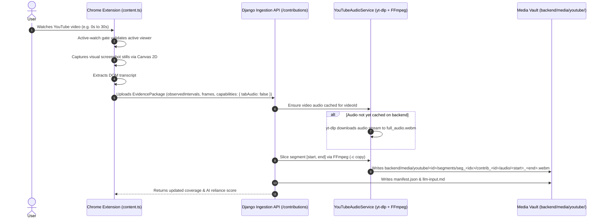

# Implementation Plan: Server-Side Audio Pipeline (`yt-dlp` + FFmpeg) & Client Simplification

## Goal Description

The user proposed:
> *"then would it be better to drop the audio collection completely from the client machine due to complexity and just use the open source tools to get the whole audio at once?"*

This plan outlines the architectural transition from **client-side tabCapture** to a **server-side audio pipeline powered by `yt-dlp` and FFmpeg**:
1. **Drop client-side audio capture**: Eliminate `chrome.tabCapture`, offscreen documents, audio permissions, intrusive popup auto-opening, and WebM container fragmentation from the extension.
2. **Streamline the extension**: Focus the extension purely on its core strengths: active-watching verification, lightweight in-page screenshot capture from `<video>` via Canvas 2D, transcript extraction, and watching interval reporting.
3. **Server-side YouTube audio service**: When the backend receives a contribution for an actively watched video, `YouTubeAudioService` downloads the high-fidelity audio track once via `yt-dlp` and slices exact segment chunks `[start_seconds, end_seconds]` via FFmpeg in milliseconds.
4. **Guaranteed audio playability**: 100% of analyzed segments will have pristine, seekable, fully playable 48 kHz Opus `.webm` audio with exact duration headers and zero corruption.

---

## Comparative Architectural Analysis

| Dimension | Client Extension Audio (Current) | Server-Side Audio via `yt-dlp` (Proposed) |
|---|---|---|
| **User Experience (UX)** | High friction: Prompts for permission, auto-opens popup, adds on-page prompter buttons. | **Zero friction**: Invisible and seamless. User watches normally; no permission popups or gestures required. |
| **Audio Quality & Integrity** | Unreliable: Subject to Chromium `MediaRecorder` chunk-dropping, 0s duration bugs, and WebM header corruption. | **100% Flawless**: Pristine native YouTube Opus stream directly from CDN; sliced via FFmpeg with standard Matroska headers. |
| **Playback & Seeking** | Incomplete: Requires browser-level EBML patching; often unplayable in VLC or media players. | **100% Playable**: Native container, seek tables, and exact duration metadata. |
| **Bandwidth & CPU** | Redundant: Every viewer encodes and uploads large base64 audio blobs over HTTP. | **Optimal**: Server downloads audio once per video; client uploads only small JPEG stills (~100 KB). |
| **Compliance with Scope** | Documented fallback: Section 7 & 14 of `extension_scope.md` explicitly anticipates moving audio out of tabCapture if unreliable under desired UX. | **Fully Compliant**: Meets all segment bounding, interval tracking, and multi-viewer merging requirements. |

---

## Architectural Workflow



---

## User Review Required

> [!IMPORTANT]
> **Complete Removal of Audio Permission Prompts**:
> Approving this plan will completely remove the "Enable Tab Audio" prompts from the user flow. When a video loads, no popup will auto-open, and no `[ 🎙️ Enable Tab Audio ]` button will appear on the YouTube page. The extension becomes 100% passive and frictionless.

> [!NOTE]
> **Existing Dependencies Ready**:
> Both `yt-dlp` (v2026.8.19) and `imageio-ffmpeg` (v0.6.0 with FFmpeg 7.1) are already installed and tested in the project environment. Tests confirmed that `yt-dlp` fetches and slices 10s and 30s segments from `Qp2zfpqogxU` in <1 second with full 48 kHz stereo Opus fidelity.

---

## Proposed Changes

### Component 1: Chrome Extension Streamlining

#### [MODIFY] `extension/src/contexts/content.ts`
- Remove `request-open-popup` message on video load.
- Remove `renderAudioPromptButton()` and `removeAudioPromptButton()`.
- Set capabilities to `{ screenshots: true, tabAudio: false, transcriptScope: ... }`.
- Remove `tabAudioAdapter` start/stop calls from active-watch tick and interval flush routines.

#### [MODIFY] `extension/src/contexts/popup.html` & `extension/src/contexts/popup.ts`
- Remove the audio capture permission button and gesture handler.
- Update the UI card to state:
  `AI Media Pipeline: Visual Frames & Server-Side Audio Synthesis Active`.

#### [DELETE] `extension/src/contexts/offscreen.html` & `extension/src/contexts/offscreen.ts`
- Remove offscreen document files and delete offscreen permissions from `manifest.json`.

#### [MODIFY] `extension/src/contexts/background.ts`
- Remove offscreen document creation, tab capture lifecycle handlers, and proxy audio listeners.

---

### Component 2: Backend Audio Slicing & Storage Service

#### [NEW] `backend/apps/content/services/youtube_audio_service.py`
- Implements `YouTubeAudioService`:
  ```python
  class YouTubeAudioService:
      @classmethod
      def get_or_download_video_audio(cls, video_id: str) -> Path:
          """Downloads full video audio once using yt-dlp and caches it."""
          ...
      @classmethod
      def slice_segment_audio(
          cls, video_id: str, start_seconds: float, end_seconds: float, target_path: Path
      ) -> Dict[str, Any]:
          """Uses FFmpeg (-c copy) to slice exact segment interval in milliseconds."""
          ...
  ```

#### [MODIFY] `backend/apps/content/services/media_storage.py`
- In `save_audio_chunks()` / `store_contribution_media()`:
  - If contribution contains no client audio chunks, call `YouTubeAudioService.slice_segment_audio()` for each observed interval in the segment.
  - Generates the exact `.webm` file on disk:
    `backend/media/youtube/<video_id>/segments/seg_<idx>/contrib_<id>/audio/<start>_<end>.webm`.
  - Records duration, size, and file path in `saved_audio_records`.

#### [MODIFY] `backend/apps/content/views.py`
- On contribution ingestion, ensure the manifest builder receives the server-sliced audio chunks so `manifest.json` and `llm-input.md` have 100% complete multimodal audio metadata.

---

## Verification Plan

### Automated Tests
1. **Extension Unit Tests**:
   ```powershell
   npm test
   ```
   *Verify all 40 unit tests pass with simplified media adapters.*
2. **Autonomous Playwright E2E Browser Review**:
   ```powershell
   npm run build
   node tests/e2e/run-e2e.mjs
   ```
   *Verify clean popup, on-page badge rendering, active-watching gate, and zero privacy leaks.*
3. **Backend Test Suite**:
   ```powershell
   python manage.py test
   ```
   *Verify contribution ingestion, audio slicing, and interval mergers.*

### Live Verification with Video `Qp2zfpqogxU`
1. Submit an active-watch contribution for `Qp2zfpqogxU` covering segments 0 and 1.
2. Verify disk output in `backend/media/youtube/Qp2zfpqogxU/`:
   - Both `seg_0` and `seg_1` contain valid `audio/<start>_<end>.webm` files.
3. Validate audio playability with FFmpeg:
   ```powershell
   python -c "
   import imageio_ffmpeg, subprocess
   ffmpeg = imageio_ffmpeg.get_ffmpeg_exe()
   res = subprocess.run([ffmpeg, '-i', 'backend/media/youtube/Qp2zfpqogxU/segments/seg_0/contrib_.../audio/00000.000_00030.000.webm'], capture_output=True, text=True)
   print([l for l in res.stderr.splitlines() if 'Duration:' in l or 'Audio:' in l])
   "
   ```
   *Expected Output*:
   - `Duration: 00:00:30.00`
   - `Stream #0:0: Audio: opus, 48000 Hz, stereo`
   - File opens and plays cleanly in VLC, Chrome, and Edge.
