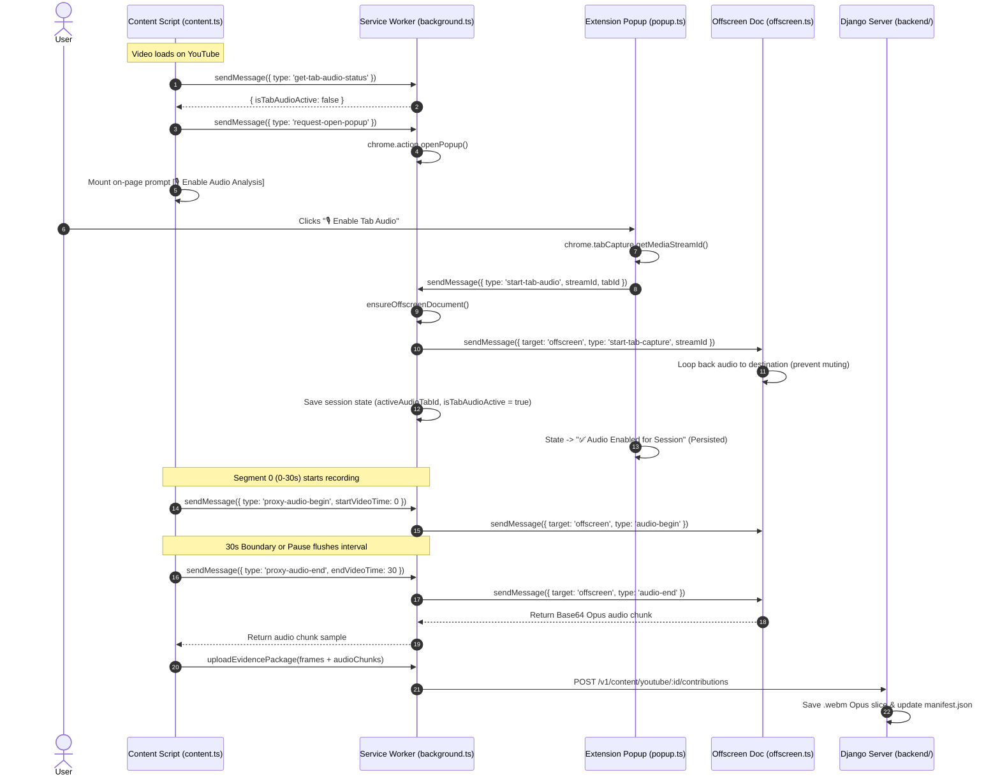

# Implementation Plan: Tab Audio Capture Bridge & Popup UX Optimization

> **Target Platform**: Google Chrome Manifest V3 Desktop Extension & Django Ingestion Backend  
> **Source Analysis**: [`docs/memo/AUDIO_CAPTURE_ANALYSIS_AND_MEMO.md`](file:///C:/Users/Lakshya/Desktop/AI%20Project/docs/memo/AUDIO_CAPTURE_ANALYSIS_AND_MEMO.md)  
> **Reported Issues**:
> 1. In-page capture yields 0s audio on live YouTube videos due to MSE separate SourceBuffers.
> 2. The "Enable Audio" button is passive and hidden inside the popup upon video load, causing friction.
> 3. After enabling audio, closing and reopening the popup resets the button state, repeatedly asking for permission.

---

## 1. Goal Description

This change delivers a complete, seamless **Tab Audio Capture Pipeline** for Chrome MV3 on YouTube, addressing both the architectural media capture limitations and the user experience friction points:
1. **Automatic Video-Load Audio Prompt**: When a user navigates to an actively watched YouTube video and tab audio is not yet enabled for the session, the extension will automatically trigger the popup (`chrome.action.openPopup()`) and display a non-intrusive on-page trigger near the player controls to minimize UX friction.
2. **Persistent Audio Session State**: The audio authorization state will be tracked in the Service Worker and `chrome.storage.session`. When the popup is closed and reopened, it will query the session state and correctly display **"✅ Audio Enabled for Session"** (disabled, success state) without resetting.
3. **Offscreen TabCapture Audio Bridge**: When authorized, the background Service Worker launches and coordinates an Offscreen Document (`src/contexts/offscreen.html`) that captures the tab audio stream, loops it back to `audioContext.destination` (preventing video muting), records Opus slices during 30s segment intervals, and returns Base64 `.webm` chunks for backend upload.

---

## 2. User Review Required

> [!IMPORTANT]
> **Browser User Gesture Requirement**:
> Google Chrome's security model strictly requires an explicit user gesture (such as clicking a button in the popup or on the page) to issue a `tabCapture` stream ID.
> - While `chrome.action.openPopup()` will be triggered automatically when the video loads, Chrome may occasionally restrict programmatic popup opening if the window does not have active system focus.
> - To guarantee a frictionless experience, we implement a **dual-prompt strategy**: `chrome.action.openPopup()` is called immediately, and a stylish floating on-page prompt button (`[ 🎙️ Enable Audio Analysis ]`) is rendered right next to the YouTube badge mount point. Clicking the on-page button immediately focuses/opens the popup.

> [!NOTE]
> **Audio Loop-Back & Zero Muting**:
> When `tabCapture` is initiated, Chrome automatically mutes the captured tab by default. Our offscreen document connects the incoming `MediaStream` directly to an `AudioContext.destination` node. This guarantees that **video audio continues playing normally out of the user's speakers** without volume drops or lag.

---

## 3. Architecture Overview & Data Flow



---

## 4. Proposed Changes

### Component 1: Background Service Worker & Offscreen Coordinator

#### [MODIFY] [`extension/src/contexts/background.ts`](file:///C:/Users/Lakshya/Desktop/AI%20Project/extension/src/contexts/background.ts)
- Add `activeAudioTabId: number | null` and `isTabAudioActive: boolean` session state.
- Implement `ensureOffscreenDocument()` to lazily spawn `src/contexts/offscreen.html` with reason `USER_MEDIA`.
- Add message handlers:
  - `'start-tab-audio'`: Launches offscreen document, passes `streamId`, records session state, and notifies content script.
  - `'get-tab-audio-status'`: Returns current tab audio state so popup can restore state upon opening.
  - `'request-open-popup'`: Attempts `chrome.action.openPopup()`.
  - `'proxy-audio-begin'`: Forwards `audio-begin` to offscreen document.
  - `'proxy-audio-end'`: Forwards `audio-end` to offscreen document and returns Base64 audio chunk to content script.
  - `'proxy-audio-cancel'`: Forwards `audio-cancel` to offscreen document.
- Add lifecycle listeners (`chrome.tabs.onRemoved`, `chrome.tabs.onUpdated`) to clean up offscreen audio when the captured YouTube tab is closed or navigated away.

---

### Component 2: Extension Popup UI & State Persistence

#### [MODIFY] [`extension/src/contexts/popup.ts`](file:///C:/Users/Lakshya/Desktop/AI%20Project/extension/src/contexts/popup.ts)
- In `initPopup()`:
  - Query background via `get-tab-audio-status` for the current active tab.
  - If already active, immediately render:
    - Text: **"✅ Audio Enabled for Session"**
    - Class: `btn btn-success`
    - Disabled: `true`
  - If inactive, render **"🎙️ Enable Tab Audio for Session"** (`btn btn-secondary`).
- In `enableAudioBtn` click handler:
  - Acquire `streamId` via `chrome.tabCapture.getMediaStreamId({ targetTabId: tab.id })`.
  - Send `{ type: 'start-tab-audio', streamId, tabId: tab.id }` to background.
  - Transition button to success state.

#### [MODIFY] [`extension/src/contexts/popup.css`](file:///C:/Users/Lakshya/Desktop/AI%20Project/extension/src/contexts/popup.css)
- Add `.btn-success` styles:
  ```css
  .btn-success {
    width: 100%;
    background: #dcfce7;
    color: #15803d;
    border: 1px solid #86efac;
    cursor: default;
  }
  ```

---

### Component 3: Content Script Media Pipeline & On-Page Prompter

#### [MODIFY] [`extension/src/adapters/media/ChromeTabAudioCaptureAdapter.ts`](file:///C:/Users/Lakshya/Desktop/AI%20Project/extension/src/adapters/media/ChromeTabAudioCaptureAdapter.ts)
- Refactor `startSegmentRecording`, `stopAndFlushRecording`, and `abortAndDiscard` to delegate directly through background Service Worker IPC messages (`proxy-audio-begin`, `proxy-audio-end`, `proxy-audio-cancel`).
- Remove direct `chrome.offscreen` calls from the content-script adapter (since `chrome.offscreen` is unavailable in content scripts).

#### [MODIFY] [`extension/src/contexts/content.ts`](file:///C:/Users/Lakshya/Desktop/AI%20Project/extension/src/contexts/content.ts)
- Introduce `CompositeMediaCaptureAdapter`:
  - Delegates screenshots to `InPageMediaCaptureAdapter.captureFrame` (canvas-based).
  - Delegates audio recording to `ChromeTabAudioCaptureAdapter` when tab audio is enabled, falling back to in-page audio or graceful null audio when disabled.
- In `onVideoNavigated(videoId)`:
  - Check tab audio status via background message.
  - If inactive and user contribution is enabled:
    - Send `{ type: 'request-open-popup' }` to background to automatically open the extension popup.
    - Render a prominent on-page prompt button (`[ 🎙️ Enable Audio Analysis ]`) on the badge mount point.
    - Clicking the button requests popup opening.
    - Once tab audio is authorized, the prompt button cleanly transitions to active or disappears.
- Ensure audio slices returned during interval flushes are included in `EvidencePackage.audioChunks` and uploaded to the server.

---

### Component 4: Documentation & Status Updates

#### [MODIFY] [`docs/memo/AUDIO_CAPTURE_ANALYSIS_AND_MEMO.md`](file:///C:/Users/Lakshya/Desktop/AI%20Project/docs/memo/AUDIO_CAPTURE_ANALYSIS_AND_MEMO.md)
- Update Section 6 checklist: Mark tab capture bridge and UX issues as resolved.
- Record the architectural resolution.

---

## 5. Verification Plan

### Automated Tests
1. **Unit Tests**:
   - Run Vitest suite:
     ```powershell
     cd "C:\Users\Lakshya\Desktop\AI Project\extension"
     npm test
     ```
   - Verify `ChromeTabAudioCaptureAdapter.test.ts` passes 100%.
2. **Build Verification**:
   - Rebuild the extension and verify bundle generation in `dist/`:
     ```powershell
     cd "C:\Users\Lakshya\Desktop\AI Project\extension"
     npm run build
     ```
3. **Backend Integration Tests**:
   - Verify Django endpoint tests:
     ```powershell
     cd "C:\Users\Lakshya\Desktop\AI Project\backend"
     python manage.py test
     ```

### Manual Verification
1. **Popup Auto-Trigger & On-Page Prompter**:
   - Load `extension/dist/` in Chrome (`chrome://extensions/`).
   - Navigate to any YouTube watch URL (e.g. `https://www.youtube.com/watch?v=...`).
   - Verify that the extension popup automatically opens (or the on-page prompt button is displayed).
2. **State Persistence Across Popup Close/Reopen**:
   - Click **"🎙️ Enable Tab Audio"**.
   - Confirm button changes to **"✅ Audio Enabled for Session"**.
   - Close the extension popup.
   - Re-open the extension popup: **Verify the button remains "✅ Audio Enabled for Session" and is disabled**.
3. **Audio Capture on Disk**:
   - Play the YouTube video for $\ge 35$ seconds.
   - Check `backend/media/youtube/<video_id>/segments/seg_0/contrib_.../audio/`:
   - **Verify a `.webm` audio file is saved on disk alongside the `.jpg` screenshots**.
   - Verify `manifest.json` contains `audio_count: 1` and `audio_chunks` entry.
