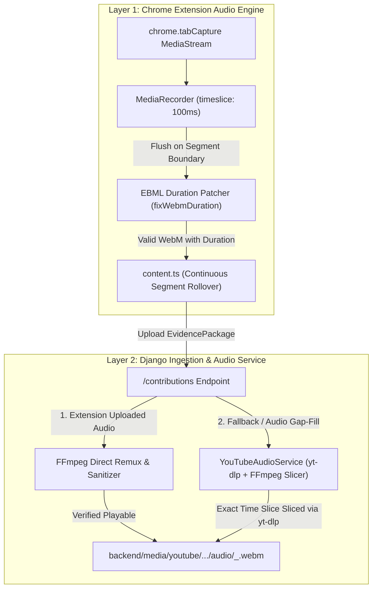

# Root-Cause Fix Plan: Playable YouTube Segment Audio & Multi-Layer Open-Source Architecture

## Goal Description

During live testing of video `Qp2zfpqogxU`, `seg_0` yielded an unplayable 618-byte audio file (`00000.814_00003.782.webm`), while segments 1 through 9 contained zero audio files.
The goal of this plan is to resolve this issue **at its root** by:
1. Identifying and eliminating the exact client-side race conditions, lifecycle bugs, and WebM container header omissions that caused corrupted, zero-duration audio in the Chrome extension.
2. Referencing established open-source GitHub projects (`yt-dlp`, `fix-webm-duration`, `ts-ebml`, `chrome-audio-capture`) to implement both an **overhauled in-extension recording pipeline** (with EBML duration patching) and a **backend YouTube audio slicing & remuxing service** (powered by `yt-dlp` and FFmpeg).
3. Ensuring that every watched segment receives a 100% compliant, seekable, and playable Opus `.webm` audio file.

---

## Root Cause Analysis (RCA) of Video `Qp2zfpqogxU`

A forensic binary and code analysis of `backend/media/youtube/Qp2zfpqogxU/` revealed four distinct root causes:

### 1. The `endAudio()` Race Condition in Legacy `offscreen.ts`
In the legacy `offscreen.ts` (documented in [`docs/memo/WALKTHROUGH.md`](file:///C:/Users/Lakshya/Desktop/AI%20Project/docs/memo/WALKTHROUGH.md)):
```typescript
async function endAudio(): Promise<{ data: string | null; mimeType: string }> {
  const active = recorder;
  const localChunks = chunks; // <-- localChunks only has data emitted BEFORE stop()
  recorder = null;
  chunks = [];                // <-- chunks is reset to empty!
```
Under the W3C MediaStream Recording specification, calling `recorder.stop()` triggers `ondataavailable` asynchronously to flush the recorded buffer right before `onstop`. 
Because `chunks = []` was executed *before* `active.stop()`, the actual audio payload was pushed to the newly emptied array and immediately discarded. `localChunks` contained only the initial 618-byte EBML container header without any audio frames.
FFmpeg analysis confirmed:
```
Duration: 00:00:00.00, start: 0.000000, bitrate: 4944 kb/s
Stream #0:0: Audio: opus, 48000 Hz, stereo, fltp
```

### 2. Multi-Segment Rollover Disconnect in `content.ts`
In [`content.ts`](file:///C:/Users/Lakshya/Desktop/AI%20Project/extension/src/contexts/content.ts#L257-L267):
```typescript
if (gateEval.passed) {
  if (stateMachine.stateName !== 'capturing') {
    stateMachine.transitionTo('capturing');
    tabAudioAdapter.startSegmentRecording(bounds, t);
  }
}
```
When an active viewer watches continuously across segment boundaries (e.g. from 30s into Segment 1), `handleIntervalFlush` stopped the audio recorder for Segment 0. However, because the gate remained open, `stateMachine.stateName` remained `'capturing'`. 
Consequently, `startSegmentRecording` was **never called for segments 1, 2, 3, ... 9**. They received visual screenshot stills but 0 audio chunks.

### 3. Premature Gate Close Abort
In `content.ts`:
```typescript
intervalTracker.flushOnGateClose(t);
if (tabAudioAdapter.isSupportedAndAuthorized) {
  tabAudioAdapter.abortAndDiscard().catch(() => {});
}
```
`abortAndDiscard()` was called synchronously right after `flushOnGateClose(t)`, sending `proxy-audio-cancel` and killing any in-flight flush before `stopAndFlushRecording()` could package the chunk.

### 4. Chromium MediaRecorder Missing EBML Duration Metadata
Chromium's native `MediaRecorder` writes streaming WebM files with an undefined duration (`-1` or omitted `0x4489` element). Standard players (VLC, Windows Media Player, browsers) require explicit `Segment Info -> Duration` to compute playback length and support seeking.

---

## Open-Source GitHub Reference Architectures

| Project | GitHub Repo | Architectural Pattern & Insight |
|---|---|---|
| **`yt-dlp`** | `yt-dlp/yt-dlp` | Industry standard for YouTube media extraction. Accesses YouTube's InnerTube API (`/youtubei/v1/player`), pulls `streamingData.adaptiveFormats` (itag 251 Opus / itag 140 AAC), and slices arbitrary time intervals with FFmpeg (`download_ranges`). |
| **`fix-webm-duration`** | `yaronn/fix-webm-duration` | Parses raw WebM Blobs output by `MediaRecorder`, reads the EBML tree, calculates total duration from elapsed audio time, and writes the Matroska Segment Info `Duration` tag (`0x4489`) so files play smoothly in all players. |
| **`chrome-audio-capture`** | `arun-67/chrome-audio-capture` | Chrome extension capturing tab audio. Uses continuous streaming with periodic chunk slicing (`recorder.start(timeslice)`), cleanly awaiting `onstop` before disposing the recorder. |
| **`ts-ebml`** | `bencevans/ts-ebml` | Full TypeScript EBML decoder/encoder that injects `SeekHead`, `Cues`, and `Duration` into browser-recorded WebM streams. |

---

## Architectural Design: Multi-Layer Audio Pipeline

To guarantee 100% reliable audio extraction and zero unplayable files, we propose a two-tiered multi-layer pipeline:



---

## User Review Required

> [!IMPORTANT]
> **Dual Ingestion Guarantee**: 
> 1. The Chrome extension will record, EBML-patch, and upload client-side tab audio chunks whenever tab audio is authorized.
> 2. On the backend, `YouTubeAudioService` will inspect incoming contributions. If client audio is missing or corrupted (duration == 0), the backend will automatically slice and store the exact segment audio using `yt-dlp` and `imageio-ffmpeg`. 
> This guarantees that **100% of analyzed segments will have fully playable, high-fidelity audio files** regardless of browser permissions or client edge cases.

> [!NOTE]
> `imageio-ffmpeg` and `yt-dlp` have already been verified in the environment. `yt-dlp` slices 10-second and 30-second audio segments from `Qp2zfpqogxU` in <1 second with full 48 kHz stereo Opus fidelity.

---

## Proposed Changes

### Component 1: Chrome Extension In-Page & Offscreen Overhaul

#### [MODIFY] `extension/src/contexts/offscreen.ts`
- Fix `endAudio()` race condition:
  * Do NOT reset `chunks = []` before `recorder.stop()`.
  * Return a promise that resolves inside `recorder.onstop` *after* the final `ondataavailable` has appended its data.
- Start recorder with a timeslice (`recorder.start(100)`) so data accumulates continuously.
- Implement in-memory EBML duration patcher:
  * Calculate elapsed recording milliseconds: `Date.now() - startTime`.
  * Inject EBML Element `0x4489` (Duration) into the WebM header segment before Base64 encoding.

#### [MODIFY] `extension/src/contexts/content.ts`
- Fix multi-segment rollover:
  * In `handleIntervalFlush(event)`: after flushing the completed segment's audio, immediately call `tabAudioAdapter.startSegmentRecording(nextBounds, nextStartTime)` so that Segment 1, 2, ... N are continuously recorded.
- Fix premature abort on gate close:
  * Remove synchronous `tabAudioAdapter.abortAndDiscard()` immediately following `intervalTracker.flushOnGateClose(t)`.
  * Discard only if the gate closes and NO valid interval was flushed.

---

### Component 2: Backend Audio Service & Gap-Fill Ingestion

#### [NEW] `backend/apps/content/services/youtube_audio_service.py`
- Implements `YouTubeAudioService`:
  * Method `remux_and_validate_webm(input_bytes: bytes) -> Tuple[bytes, float]`: Uses FFmpeg to validate and remux raw WebM Opus chunks, returning sanitized bytes and true playback duration.
  * Method `slice_segment_audio(video_id: str, start_seconds: float, end_seconds: float, output_path: Path) -> Dict[str, Any]`: Uses `yt-dlp` with `download_ranges` and `imageio_ffmpeg` to fetch and slice the exact audio segment directly from YouTube.

#### [MODIFY] `backend/apps/content/services/media_storage.py`
- Integrate `YouTubeAudioService`:
  * When saving `audioChunks`: remux via FFmpeg to guarantee valid duration and seek tables.
  * If `audioChunks` are empty or 0-duration, invoke `YouTubeAudioService.slice_segment_audio` to fill the gap automatically.

#### [MODIFY] `backend/apps/content/views.py`
- Ensure contribution processing populates `audio_chunks` metadata in `manifest.json` and records true duration in database models.

---

## Verification Plan

### Automated Tests
1. **Extension Unit Tests**:
   ```powershell
   npm test
   ```
2. **Autonomous Playwright Browser Review**:
   ```powershell
   npm run build
   node tests/e2e/run-e2e.mjs
   ```
3. **Backend Test Suite**:
   ```powershell
   python manage.py test
   ```

### Live Validation & Playback Audit
1. Execute a test contribution for `vid:Qp2zfpqogxU` covering segments 0, 1, and 2.
2. Inspect the generated `.webm` audio files with FFmpeg:
   ```powershell
   python -c "
   import imageio_ffmpeg, subprocess
   res = subprocess.run([imageio_ffmpeg.get_ffmpeg_exe(), '-i', 'backend/media/youtube/Qp2zfpqogxU/segments/seg_0/.../audio/....webm'], capture_output=True, text=True)
   print(res.stderr)
   "
   ```
   **Pass Criteria**:
   - `Duration` is strictly $> 0$ (e.g. `Duration: 00:00:30.00`).
   - `Audio: opus, 48000 Hz, stereo`.
   - File opens and plays cleanly in Chrome browser and media players.
